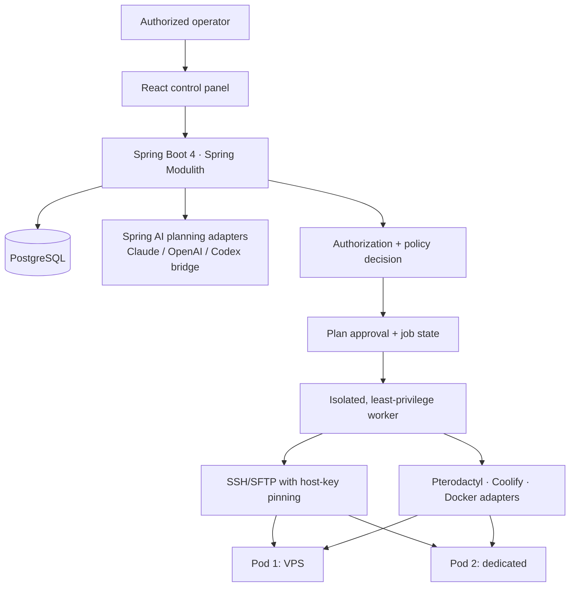

# MONIQUE

**MONIQUE — AI Infrastructure & Server Administrator** is a self-hosted control plane for managing VPS and dedicated machines through a web interface and AI-assisted, policy-governed operations.

> **Status: engineering prototype, NOT production-ready.** The architectural documents describe the **intended system**, not functionality that is already delivered. SSH execution, secure host inventory, production migrations, and unattended server administration are **not yet implemented**.

The implementation target is **Java 21, Spring Boot 4.1.2, Spring Modulith 2.1.1, Spring AI 2.0.2, PostgreSQL and React/TypeScript**. Modular monolith first, isolated asynchronous workers when required. Version selection was checked against official Spring documentation in November 2026.

## Documentation

| Document | Engineering scope |
|---|---|
| [Documentation index](docs/README.md) | Reading guide, design status and terminology |
| [Architecture](docs/ARCHITECTURE.md) | System context, trust boundaries, C4-inspired diagrams, deployment |
| [Spring platform stack](docs/SPRING-STACK.md) | Selected Spring projects, dependencies, rationale, deferred technology |
| [Spring Modulith design](docs/SPRING-MODULITH.md) | Module ownership, API boundaries, event flow, enforceable dependencies |
| [AI orchestration](docs/AI-ARCHITECTURE.md) | Claude, Codex, Spring AI and the policy-controlled tool gateway |
| [Execution and migration](docs/EXECUTION-AND-MIGRATIONS.md) | Job lifecycle, approvals, SSH, backups, Coolify / Pterodactyl |
| [Security](docs/SECURITY.md) | Threat model, control requirements and current implementation gaps |
| [Data and APIs](docs/DATA-AND-API.md) | Database ownership, API contracts and concurrency |
| [Quality and roadmap](docs/QUALITY-AND-ROADMAP.md) | Verification gates, NFRs and delivery milestones |
| [Decision records](docs/adr/README.md) | Rationale behind architectural choices |
| [Development](docs/DEVELOPMENT.md) | Prototype instructions and current caveats |

## What is a Pod?

A **Pod** is a managed VPS or dedicated server (not a Kubernetes Pod). Each can have a management hostname, SSH username and port, a secret reference, multiple IPv4/IPv6 allocations, tags, installed services, and safety policies. The system must distinguish **configured** IPs from **verified, assigned and routable** IPs.

## System overview

**Boundary:** AI models only propose plans. They do not receive SSH private keys and cannot directly bypass the authorization, approval or execution layer.

## Example intention

> “Monique, migrate all of Coolify from Pod 2 to Pod 1, including applications and databases, but preserve the existing Pterodactyl Panel, Wings, and Minecraft servers in Pod 1.”

The correct behavior is to inspect both hosts, identify network/port/storage conflicts, establish independent verified backups, present a reviewed staged plan, perform only approved steps, check service health, preserve rollback options, and **stop if a safe coexistence plan cannot be proven**.

## Actual code today

The early `backend/` prototype includes basic pod storage, encrypted stored SSH credential material, a single-token API gate, audit metadata, and direct HTTP Claude/OpenAI **planning-only** calls. This is not yet the completed Spring Modulith/Spring AI design; the formal boundaries and provider adapters will be refactored incrementally. `compose.yaml` references `frontend/`, which is not yet available, so the full Docker stack **is not runnable** in its current state. Do not deploy to production or supply production credentials.

**Engineering rule:** never mark a planned capability “implemented” without passing integration, safety, and failure-mode tests.

Maintained by [OreoStudios](https://github.com/OreoStudios). License to be determined.
