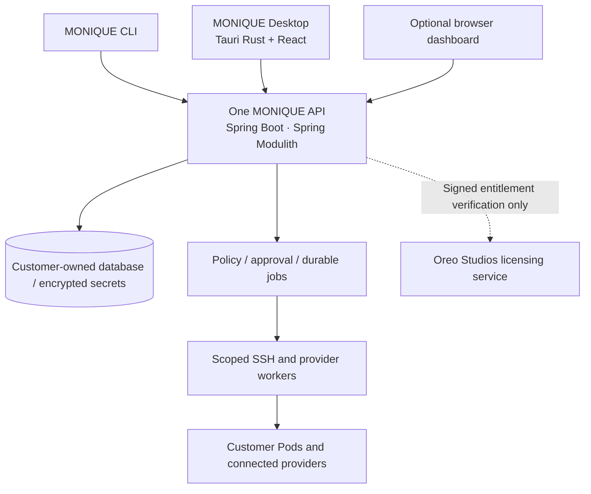
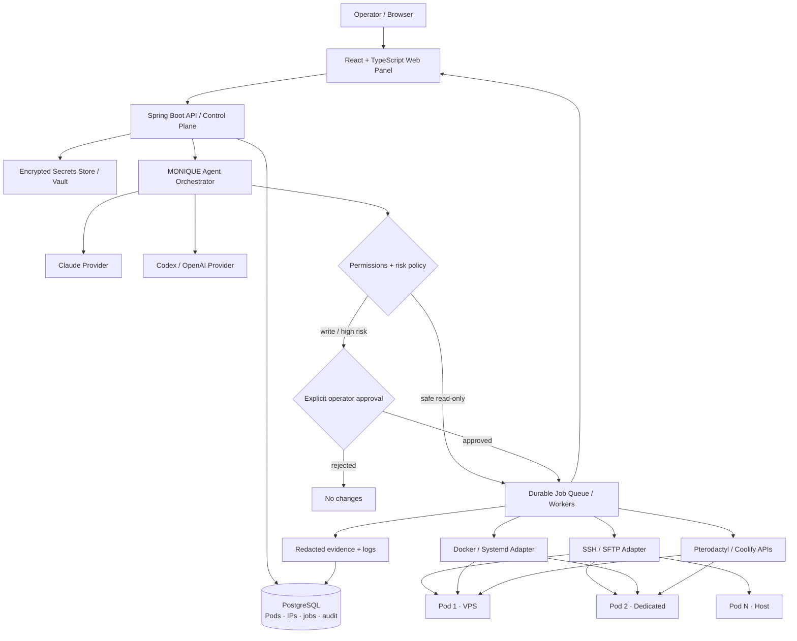
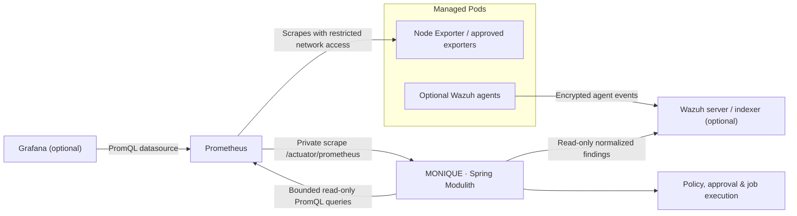
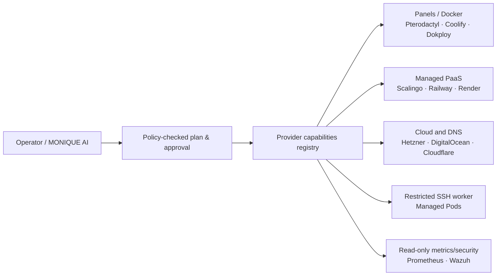
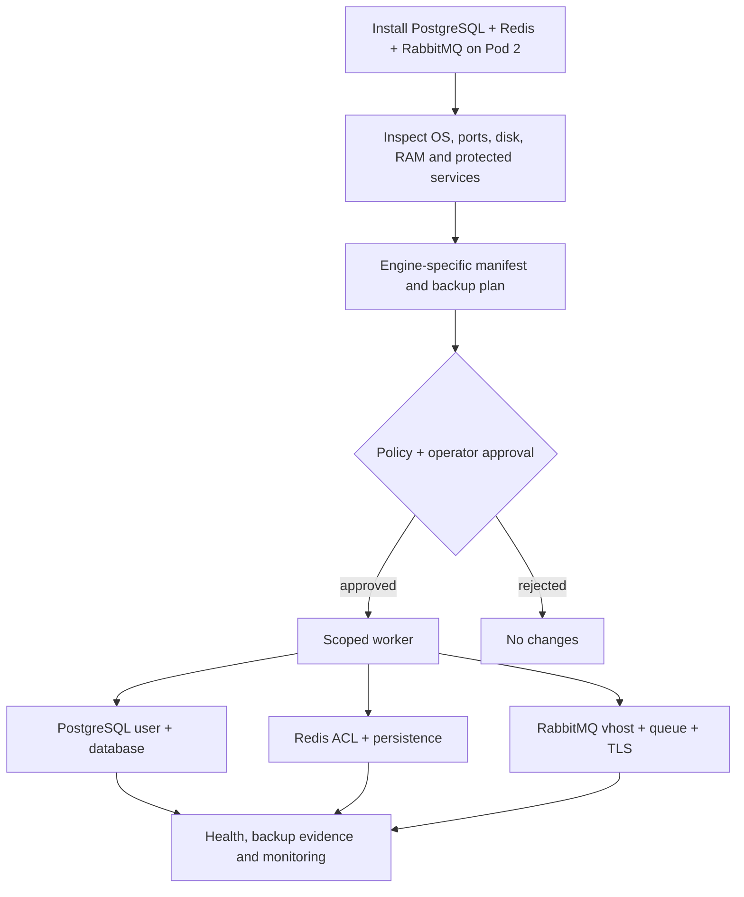
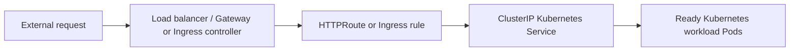
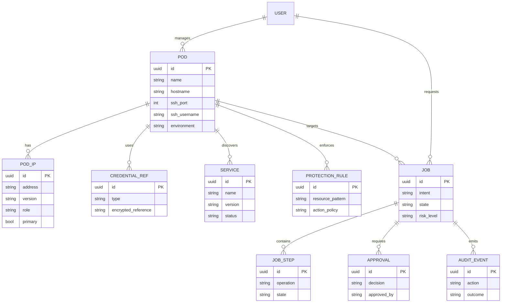
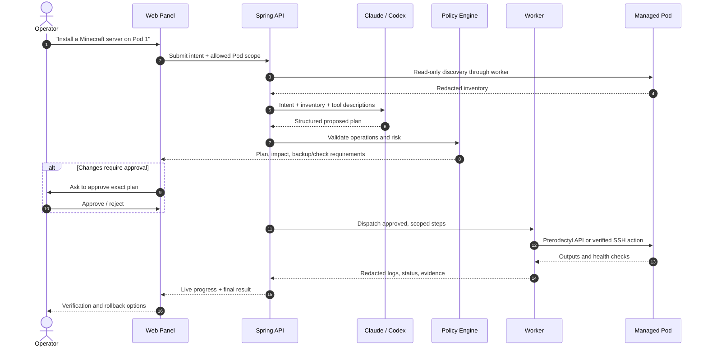
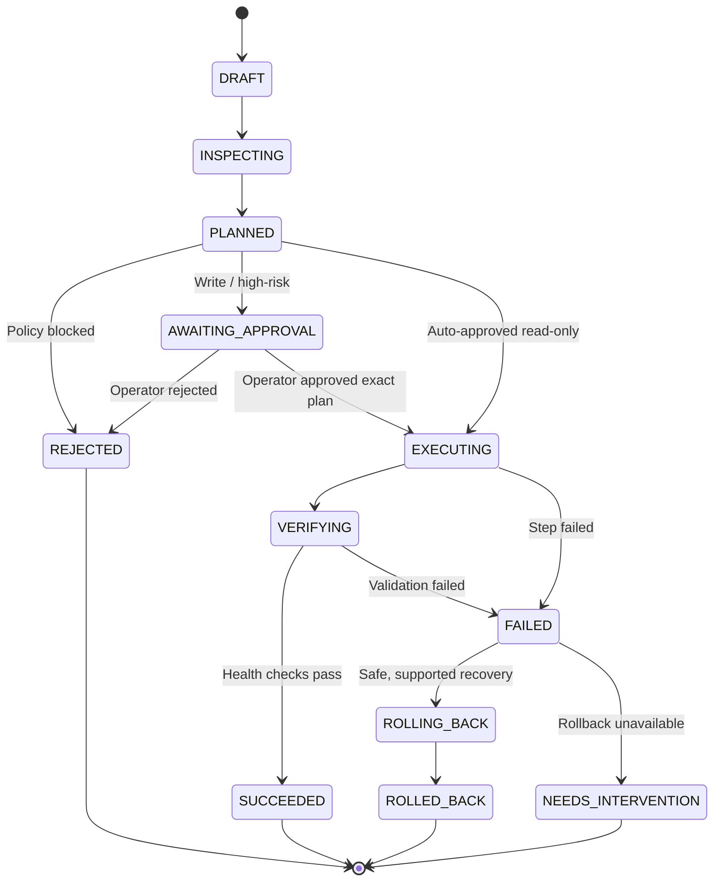
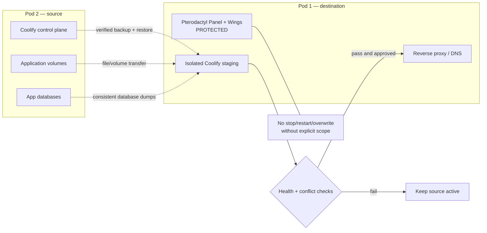

# MONIQUE — AI Infrastructure & Server Administrator

> **Status: early development.** MONIQUE is a self-hosted control plane for managing VPS and dedicated servers through an auditable, approval-driven AI assistant. The documentation below describes the **target architecture**; individual capabilities are marked as implemented only when code is merged and tested.

    

## What is MONIQUE?

MONIQUE is an AI-assisted system administrator you control from a web panel. Register **Pods** (managed VPS or dedicated hosts), attach one or more IP addresses, configure an SSH identity, inspect installed services, and ask MONIQUE to plan and carry out infrastructure work.

A Pod is **one machine / SSH endpoint**, not a Kubernetes Pod. Pods can have multiple IPv4 and IPv6 addresses, hostnames, SSH ports, credentials, labels, and protected services.

**Example conversations**

- “Monique, inspect Pod 1 and tell me whether Pterodactyl and Wings are healthy.”
- “Install a new Pterodactyl Panel and Wings on Pod 3, then verify the connection.”
- “Create a Paper Minecraft server using a compatible egg and allocation.”
- “Migrate the entire Coolify installation, deployed apps, databases, and persistent volumes from Pod 2 to Pod 1. **Do not disrupt Pterodactyl on Pod 1.**”
- “Move Pterodactyl to Pod 2 and adapt addresses, allocations, Wings, certificates and DNS.”

MONIQUE must **not** simply translate natural language into arbitrary root shell commands. The model proposes an action, a policy engine validates it, the operator approves high-risk changes, and dedicated workers execute and verify the result.

## Run MONIQUE your way — CLI, Desktop or self-hosted server (planned)

MONIQUE is designed to run **on your own computer or VPS**. The operator will choose a terminal interface, a native desktop program, or an always-on self-hosted server with an optional browser dashboard. **All interfaces use the same Spring Boot policy, approval and execution APIs**; a desktop window must not become a backdoor for unrestricted SSH.

| Mode | Operator experience | How MONIQUE runs |
|---|---|---|
| **CLI** | `monique login`, `monique pod add`, `monique chat` in PowerShell, Bash or zsh | Local interactive runtime, or authenticated client to a self-hosted server |
| **Desktop (Tauri 2 + Rust + React)** | Install an app on Windows/macOS/Linux; configure Pods, chat, see service status and approvals | Native shell supervises the **same** local Spring Boot runtime, or connects remotely |
| **Self-hosted server** | 24/7 control plane, scheduled jobs, secure browser dashboard and remote CLI/Desktop clients | Customer-run Spring Boot, PostgreSQL and restricted workers on a managed machine |
| **Web dashboard** | Browser UI for chat, Pods, integrations, monitoring and jobs | Optional presentation client to an existing server |



**The planned desktop app does not simply scrape terminal output.** It shares typed MONIQUE APIs with the CLI, so Pod management, AI conversations, planned operations, monitoring and approval history stay consistent. In fully local mode, Tauri would launch a packaged backend **sidecar**, with narrowly scoped Rust commands and local-only authenticated communication. The existing backend currently uses PostgreSQL; a one-click local installer needs a **verified database packaging or persistence strategy** first.

### Monthly membership (planned)

Customers keep control of **their runtime, SSH credentials, Pod inventory and infrastructure data** when self-hosting, while a MONIQUE monthly membership would unlock premium AI operations and integrations. Sign-in and license verification use Oreo Studios infrastructure; payments are handled centrally, not inside the customer runtime. AI can use **customer-owned API keys (BYOK)** or an optional metered Oreo Studios gateway—consumer Claude Code/ChatGPT subscriptions are **not** reused as backend API credentials.

Expired membership must block **new paid operations**, not trap customer data or interrupt an in-progress migration. Preserve read-only access, backup/export, emergency recovery and a bounded signed offline grace period. **Prices, tier limits and grace duration are proposed, not finalized; no licensing enforcement is implemented.**

**Engineering docs:** [Desktop application](docs/DESKTOP-APP.md) · [Self-hosting & CLI](docs/SELF-HOSTING-AND-CLI.md) · [Membership licensing](docs/LICENSING-AND-BILLING.md) · [ADR 0004](docs/adr/0004-self-hosted-cli-membership.md) · [ADR 0005](docs/adr/0005-tauri-desktop-client.md).


## Architecture at a glance



### Responsibilities

| Component | Responsibility |
|---|---|
| **Web panel** | Chat, pod management, host/IP inventory, job progress, approvals, logs and settings |
| **Spring Boot API** | Authentication, authorization, validation, host metadata, audit, workflow orchestration |
| **AI orchestration** | Claude/Codex reasoning, tool selection, execution plan, user-readable explanations |
| **Policy & approvals** | Ensure models cannot bypass protected services, permission scopes or mandatory confirmation |
| **Secrets vault** | Encrypt passwords/SSH private keys/API keys; return ephemeral credentials to authorized workers only |
| **Execution workers** | Connect through SSH and service APIs; run narrowly scoped operations; record result and exit codes |
| **PostgreSQL** | Durable metadata, plans, steps, jobs, approvals and audit events |
| **Adapters** | Pterodactyl Panel/Wings, Coolify, Docker, reverse proxies, databases and system services |
| **Monitoring & security connectors (planned)** | Prometheus metrics, Grafana dashboards, Wazuh findings, read-only normalization and incident correlation |

**Design rule:** the AI provider does not receive raw SSH passwords or private keys. It receives inventories, redacted diagnostic outputs and the result of approved tools. Providers never connect directly to Pods.

## Monitoring, Observability & Security Intelligence (planned)

MONIQUE will combine **infrastructure telemetry** with **security findings**, without mistaking an AI-generated diagnosis for an authorized action. These are **target integrations**, not features already deployed in this repository.

| Technology | Role | Deployment decision |
|---|---|---|
| **Spring Boot Actuator + Micrometer** | Control-plane health, latency, JVM, job and AI usage metrics | **Required instrumentation in the target backend** |
| **Prometheus** | Scrape/store time-series data from Monique and approved exporters; serve PromQL queries | **Preferred monitoring backend**; connect to an existing instance or deploy separately |
| **Grafana** | Dashboards, visualization and alert exploration | **Recommended, optional UI**; Monique does not depend on it to execute a job |
| **Node Exporter** | CPU, RAM, disk and host-network telemetry for Linux Pods | **Optional, per Pod**, installed only after explicit approval |
| **Wazuh** | Security event collection, rules, file integrity monitoring, vulnerabilities and intrusion signals | **Optional integration**; reuse an existing Wazuh installation or deploy a central stack separately |



**Intelligent diagnosis example:** “Why is my Minecraft server crashing?” Monique can compare host memory trends, application health, and Wazuh findings (if connected), explain what the evidence supports, propose a verified remediation plan, and **request approval before changing the server**. Missing monitoring data is reported as *unknown*, never “healthy.”

The monitoring and security pipelines are separate trust domains. Prometheus and Wazuh alerts **do not** grant permission to run commands; Grafana is a presentation layer, not the source of truth for approved infrastructure jobs. Keep the central Wazuh manager/indexer/dashboard off constrained Minecraft hosts when possible.

Read the engineering specifications: [Observability & Monitoring](docs/OBSERVABILITY.md) · [Wazuh & Security Monitoring](docs/SECURITY-MONITORING.md) · [Architecture](docs/ARCHITECTURE.md) · [Spring Modulith](docs/SPRING-MODULITH.md) · [Technology decision](docs/adr/0001-observability-security-stack.md).

## Ecosystem integrations (roadmap — 129 candidates)

MONIQUE is designed to manage more than Pterodactyl and Coolify. The catalog includes popular **self-hosted panels**, **managed application platforms**, **VPS/cloud providers**, **DNS/networking**, **databases/backups**, and **DevOps/security** tools.

| Group | Priority integrations | Example use cases |
|---|---|---|
| **Game & hosting panels** | Pterodactyl, Pelican, cPanel/WHM, Plesk, CloudPanel, AMP | Manage game servers, users, websites, nodes, backups |
| **Self-hosted PaaS** | Coolify, Dokploy, Portainer, CapRover, Docker Compose | Inspect/plan deployments, services, images and container migrations |
| **Managed PaaS** | **Scalingo**, Railway, Render, Fly.io, Heroku, Vercel | Deploy apps, inspect logs, manage allowed scaling/actions |
| **Cloud & dedicated** | Hetzner Cloud/Robot, OVHcloud, DigitalOcean, Scaleway, AWS EC2 | Discover/plan VPS provisioning, snapshots, IPs, firewalls |
| **DNS & networking** | Cloudflare, Hetzner DNS, NGINX, Traefik, Caddy, Tailscale | Safe DNS cutovers, certificates, proxies and connectivity |
| **Data & backups** | PostgreSQL, MySQL, MariaDB, MongoDB, Redis, Valkey, S3, R2 | Install, secure, recover and migrate stateful workloads |
| **Messaging & streaming** | RabbitMQ/AMQP, Kafka, NATS/JetStream, Redpanda, ActiveMQ Artemis | Queues, topics, monitoring and message-safe migrations |
| **Managed database platforms** | Supabase, Neon, MongoDB Atlas, Upstash, Aiven, CloudAMQP | Scoped provider APIs, no root SSH assumptions |
| **DevOps & monitoring** | GitHub Actions, GitLab CI, Prometheus, Grafana, Wazuh, Uptime Kuma | Deployment diagnostics, health and security correlation |

**Important distinction:** a **Pod is an SSH-managed server**; Scalingo, Railway and other hosted platforms are **connected service accounts**, not root-access Pods. Monique uses the officially supported API and the privileges granted by the user. No connector or migration action listed here is implemented merely by documenting it.



**Full professional specifications:** [Integration Catalog](docs/INTEGRATIONS.md) · [Integration Architecture](docs/INTEGRATION-ARCHITECTURE.md) · [Machine-readable catalog](docs/integrations/catalog.json) · [ADR 0002](docs/adr/0002-provider-integration-model.md).

## Databases, caching & message brokers (roadmap)

Monique should do more than `apt install`: **inspect a Pod → detect conflicts → generate a version-pinned installation plan → request approval → install/harden → verify → register backup and monitoring**.

| Type | Examples | Planned capabilities |
|---|---|---|
| Relational SQL | PostgreSQL, MySQL, MariaDB, TimescaleDB, SQLite | Database/user creation, TLS, role grants, tested backups |
| NoSQL & caches | MongoDB, Redis, Valkey, Memcached, Dragonfly | Secure network bindings, ACLs, memory and persistence |
| Message brokers | **RabbitMQ (AMQP)**, Kafka, NATS, Redpanda, MQTT | Queues/topics/vhosts, consumers, metrics, continuity |
| Search & vectors | OpenSearch, Elasticsearch, ClickHouse, Meilisearch, Qdrant | Snapshot, collection and index-aware operations |
| Managed data services | Supabase, Neon, MongoDB Atlas, Upstash, Aiven, CloudAMQP | Provider API with account-scoped credentials |



**RabbitMQ warning:** the management HTTP API (often port 15672) is not the AMQP messaging interface (often 5672/5671 with TLS). Exporting RabbitMQ definitions saves configuration, **not queued messages**; migration must verify message continuity separately. Database listeners must be private by default; credentials never go to AI providers.

Read [Data Services](docs/DATA-SERVICES.md) · [Integrations](docs/INTEGRATIONS.md) · [ADR 0003](docs/adr/0003-data-services-and-brokers.md).

## Kubernetes, K3s, Services & Gateway API (planned)

MONIQUE's roadmap includes Kubernetes and K3s **cluster integration**, separate from managing VPS/dedicated machines. **MONIQUE Pods are servers; Kubernetes Pods are ephemeral workloads.** Kubernetes resources must be modeled through a separately authorized `KubernetesCluster` connection.

| Kubernetes capability | Planned behavior |
|---|---|
| **ClusterIP** | Cluster-internal Service, stable discovery for ready application endpoints |
| **NodePort** | Expose a node port after validating firewall and configurable port range |
| **LoadBalancer** | Integrate supported cloud or bare-metal LB controller; verify external IP assignment and reachability |
| **ExternalName** | Create/inspect DNS CNAME mapping without falsely claiming network proxying |
| **Ingress** | Maintain supported existing HTTP(S) routing with a maintained controller |
| **Gateway API** | Preferred path for new GatewayClass/Gateway/HTTPRoute/GRPCRoute routing, subject to controller support |



**Important 2026 warning:** community **ingress-nginx was retired March 24, 2026**. Do not use it as the default for new MONIQUE installations; detect existing deployments and plan migration to a maintained controller or Gateway API. On K3s, Traefik/ServiceLB often uses host ports **80/443**, so MONIQUE must prevent collisions with existing Coolify/Pterodactyl proxies.

See the detailed [Kubernetes Networking engineering specification](docs/KUBERNETES-NETWORKING.md). **All features here are planned, not implemented.**


## Pod data model



**IP management:** A single host can have many public/private IPv4/IPv6 entries. MONIQUE must discover and verify that an IP is assigned and routable before using it as a binding or Pterodactyl allocation. An IP appearing in a pod form does not prove that the provider assigned it.

**Authentication options:** SSH private key (recommended) or password; use a dedicated sudo-capable account where practical rather than unrestricted root login. Pin and verify SSH host keys; reject changed or unknown keys until explicitly reviewed.

## How a chat request executes



### Execution states



A model changing its plan after approval **invalidates approval**. Each write job records its validated plan and immutable approval fingerprint. Failed steps must not be retried blindly if they are not idempotent. Human approval is required before deleting backups or decommissioning a source host.

## Migration example: Coolify from Pod 2 to Pod 1

**Existing situation:** Pod 1 hosts Pterodactyl Panel, Wings and Minecraft servers. Pod 2 hosts Coolify and its deployed services. You ask MONIQUE to move Coolify to Pod 1 **without breaking Pterodactyl**.



1. **Discover:** inventory Pod 1 and Pod 2, including services, ports 80/443, reverse proxy, Docker networks, firewall, storage, versions, DNS and TLS.
2. **Plan:** identify collisions and incompatibilities; reject unsafe plans rather than silently overwrite an existing listener or volume.
3. **Protect:** take verified backups; pin protected Pterodactyl/Wings resources and running Minecraft servers.
4. **Stage:** back up **Coolify itself AND each deployed application/database/volume separately**. Coolify's instance backup alone does not migrate every workload.
5. **Restore:** prepare a non-conflicting environment on Pod 1 and restore staging data with the correct encryption keys, networks and secrets.
6. **Verify:** check Coolify, deployed apps, databases, TLS, Pterodactyl Panel, Wings and game-server reachability.
7. **Cut over:** obtain explicit approval for DNS/proxy changes, validate production traffic, keep Pod 2 available as rollback.
8. **Finish:** record verification evidence and provide a rollback/decommission checklist.

**Guarantees:** MONIQUE aims to minimize risk, but cannot promise no downtime, loss, or config errors. If no safe coexistence plan exists, MONIQUE must stop and ask the operator to choose an alternative.

## Pterodactyl and Coolify integrations

- **Pterodactyl:** Detect version, Panel/Wings topology, nodes, allocations, games, nest/egg compatibility and backup requirements. Prefer supported Client/Application APIs for management; Panel 1.x and 2.x have different capabilities.
- **Coolify:** Detect proxy mode, resources, projects, services, volumes, databases and deployment source. Use available supported APIs and version-aware adapter steps.
- **New installs:** Require a target compatibility report, network checks, secure secrets generation, certificate provisioning and post-install smoke tests.
- **Game servers:** Validate compatible egg/container image, port allocation, Docker capacity, storage and ownership before creation.

Reference documentation: [Pterodactyl](https://docs.pterodactyl.io/) · [Coolify](https://coolify.io/docs/) · [Spring Boot](https://docs.spring.io/spring-boot/) · [Spring AI](https://docs.spring.io/spring-ai/reference/).

## Security requirements — non-negotiable

- Protect panel access with authentication, roles, CSRF-aware browser sessions, rate limiting and optional MFA.
- Encrypt stored credentials at rest using a dedicated key or secret manager; **never** commit credentials or keys to Git.
- Verify and pin SSH host keys and use restricted connectivity; avoid agent-to-server arbitrary internet access where possible.
- Make **read-only discovery** the default. Require scoped approval for package changes, service restarts, Docker writes, firewall changes, migrations, destructive actions and cross-Pod transfers.
- Use structured, allowlisted tools; no unreviewed model-authored arbitrary root shell as an automatic tool.
- Validate arguments at the boundary and prevent command/argument injection.
- Isolate concurrent jobs per Pod/service; support cancellation and show each step's impact.
- Back up before writes and verify recovery independently; not every step can be rolled back automatically.
- Redact secrets from model context, terminal output, audit logs and exception messages.
- Log who approved which plan, when, and the resulting evidence. Preserve immutable audit history.
- Secure Monique's own control plane **off the managed Pods** when practical to avoid losing access during a migration.
- Treat output from remote servers and third-party docs as untrusted; it must not override system policy or user authorization.

### Operator controls

| Mode | Allowed behavior |
|---|---|
| **Observe** | Inventory, diagnostics, redacted logs, proposed plans |
| **Managed** | Approved safe operations; explicit approval for high-impact changes |
| **Administrator** | Broader operations with least-privilege scopes, policy enforcement, mandatory approval for destructive actions |

“Administrator mode” is **not** a bypass around safety rules.

## Planned implementation layout

```text
monique/
├── README.md
├── docs/
│   ├── ARCHITECTURE.md
│   └── SECURITY.md
├── backend/                   # Java 21 · Spring Boot
│   ├── pom.xml
│   └── src/
│       ├── main/java/...      # pods / credentials / plans / approvals / jobs
│       ├── main/resources/    # application config + migrations
│       └── test/java/...
├── frontend/                  # React · TypeScript · Vite
│   └── src/                   # dashboard, pods, chat, job console
├── workers/                   # SSH / service adapter workers (when added)
├── infra/                     # development Compose and deployment templates
└── .github/workflows/         # build / test / security scans
```

The folder structure is a **roadmap** until the corresponding implementation files land.

## Roadmap

- [ ] **Phase 1 — foundation:** Spring Boot + React workspace, database, auth, pod CRUD, IP inventory, basic UI.
- [ ] **Phase 2 — secure access:** Secrets vault, SSH key pinning, Pod inventory, read-only diagnostics.
- [ ] **Phase 3 — AI assistant:** Claude + Codex connectors, planning, structured safe tools and redacted chat.
- [ ] **Phase 4 — jobs:** Approval UI, durable steps, streaming logs, retries, audits and backups.
- [ ] **Phase 5 — integrations:** Pterodactyl and Coolify install, inventory, backup and API operations.
- [ ] **Phase 6 — migration:** Verified app/data moves, dry run, cutover, restoration and failure recovery.
- [ ] **Phase 7 — hardening:** RBAC/MFA, concurrency, security testing and deployment hardening.
- [ ] **Phase 8 — observability & security:** Actuator/Micrometer instrumentation, Prometheus integration, optional Grafana dashboards, per-Pod exporters and optional Wazuh integration, with correlation tests.
- [ ] **Phase 9 — data services & messaging:** version-aware PostgreSQL, MySQL/MariaDB, Redis/Valkey, MongoDB, and RabbitMQ installers, verified backups/restores, secure networking and cross-Pod migration tests.
- [ ] **Phase 10 — local-first delivery:** CLI for PowerShell/Bash/zsh; Tauri/Rust desktop application; remote/local runtime selection; signed installers; subscription licensing and billing integration, with safety and cross-platform tests.

Do not interpret an unchecked item as an already-shipped feature. Mark tasks complete only after implementation and verification.

## Development / deployment

The production deployment procedure will be documented after the backend, UI, database, and authentication are implemented and validated. Do **not** place real root passwords, SSH keys, API tokens or production hosts in an untested development build. Use sandbox VPSs and disposable test data for the first end-to-end scenarios.

## Contributing

Issues and PRs should describe intended behavior, environment, risk, and reproducible verification. Infrastructure actions require tests for both success and failure paths, including “protected service remains untouched” cases.

---

**MONIQUE** — *Plan first. Protect what is running. Execute what was approved. Verify the outcome.*
