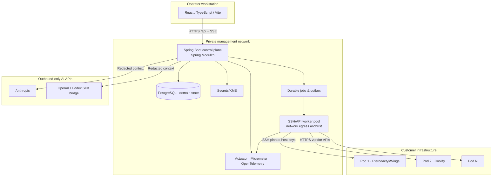
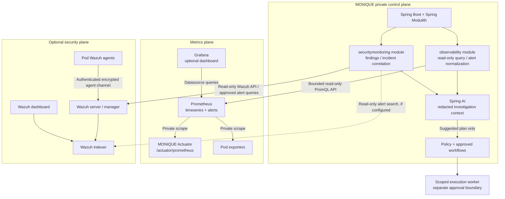
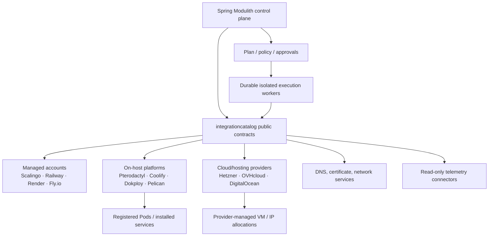
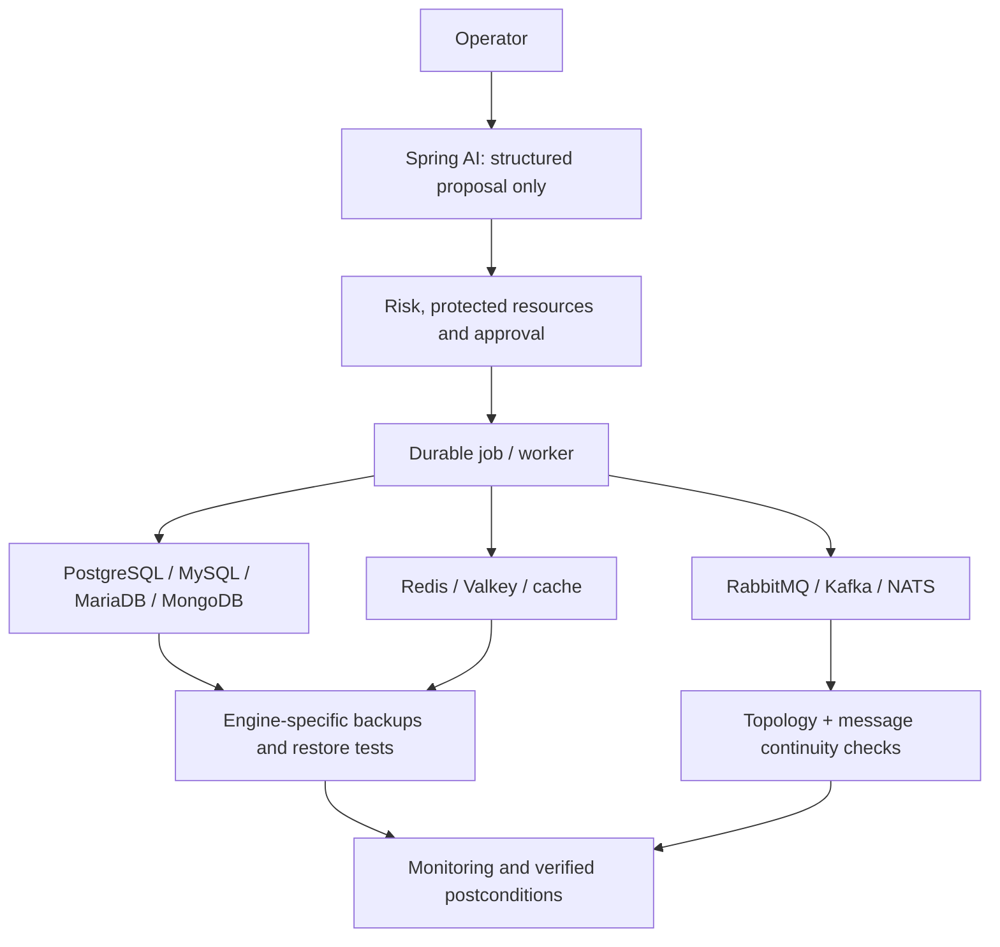
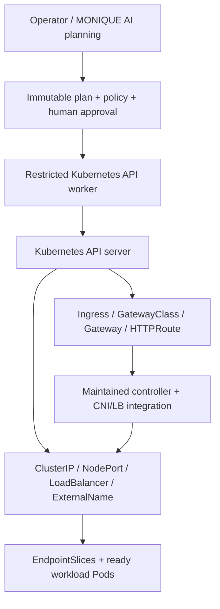
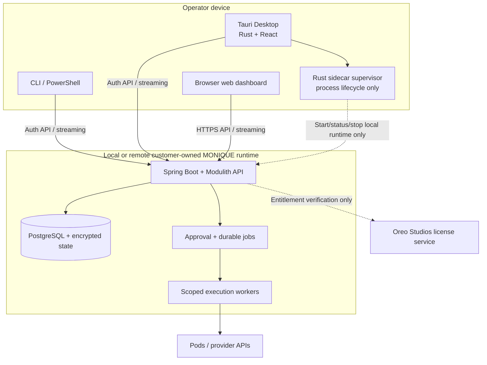
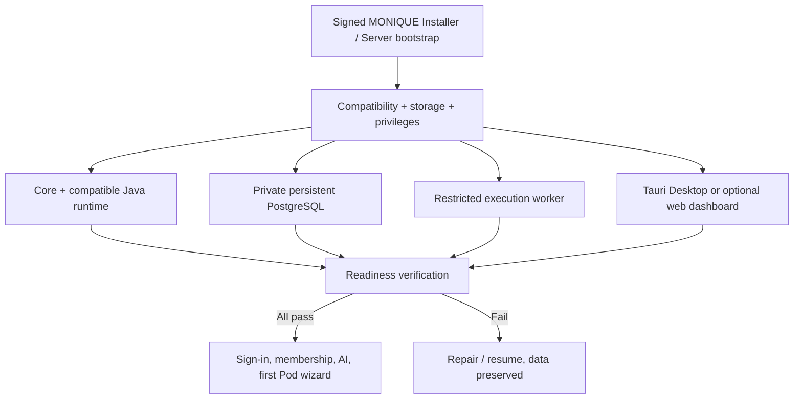

# System architecture

**Classification:** Target design, not implementation evidence. **Pattern:** Modular monolith for the control plane, independently deployable execution workers, externally managed hosts.

## System context

The trust boundary is between Monique's control plane and all third-party and remote responses. Remote command output, READMEs, package metadata, AI content and service API responses are **untrusted input**. No data from those sources may redefine operator authority.

## Container and deployment view

### Deployment principles

- Terminate TLS at a hardened reverse proxy. No direct public PostgreSQL, worker RPC, Actuator admin endpoint or SSH credentials API.
- Separate management network, identity and authorization context from each managed host. Isolate each worker's network access to assigned Pod endpoints.
- Do not mount a Docker socket inside the web/API container. The SSH or API worker has a scoped tool capability, not unconstrained host access.
- Application secrets live in a vault/KMS or encrypted store; PostgreSQL contains references/ciphertext, never raw SSH material.
- The MVP can use one database instance and isolated workers. Cross-process jobs must use a real durable queue/claim mechanism (not in-memory futures).
- Horizontal control-plane scaling is **deferred** until distributed locks and leasing are validated.

## Monitoring and security data planes (target)

MONIQUE uses **two independent sources of evidence**: a metrics data plane backed by Prometheus, and an optional security-detection data plane backed by Wazuh. Neither has direct execution authority. Grafana consumes metrics as a UI; it does not replace Prometheus storage or Wazuh detection.

**Observe vs. operate:** the observability and securitymonitoring modules gather *evidence*. The AI module can summarize findings but cannot invoke SSH or vendor write APIs. The workflow/policy boundary validates scopes, backups and approvals before any execution.

**Infrastructure independence:** monitoring central services should run on separately provisioned or existing infrastructure; avoid installing the Wazuh central stack on a memory-constrained Pod already running Pterodactyl/Minecraft. Operators can connect a managed Prometheus/Grafana/Wazuh deployment without installing duplicate services.

**Availability and failure semantics:** monitoring connectors have explicit `CONNECTED`, `DEGRADED`, `STALE`, `UNAVAILABLE` states. Metrics from an exporter that stopped reporting are **unknown**, not zero. High-risk changes that require health confirmation must block cutover when telemetry is stale or unavailable, unless an operator-approved alternative validation procedure exists. Independent external monitoring should alert if MONIQUE itself is down.

**Network boundaries:** neither Prometheus exporter endpoints nor Wazuh management/indexer APIs may be exposed unauthenticated to the public Internet. Use VPN/private networks, TLS/mTLS or a suitable authenticated proxy, least-privilege credentials, per-Pod allowlists, and server-side request limits.

**Data minimization:** labels must be bounded and never include job IDs, IP credentials, SSH keys, prompt text, arbitrary error messages or usernames. Wazuh alert bodies can contain sensitive paths, usernames and IPs, so sanitize and authorize access before storing or presenting summarized evidence to a language model.

See [Observability](OBSERVABILITY.md), [Security Monitoring](SECURITY-MONITORING.md), [Spring Modulith](SPRING-MODULITH.md), and [ADR 0001](adr/0001-observability-security-stack.md).

## Provider and integration topology (target)

Managed provider accounts, installed panels and SSH-managed Pods must be modeled as distinct resource classes. An AI agent never obtains a universal credential with unrestricted execution access.

The SPI is a **capability and metadata boundary**, not an alternative authorization path. Provider API keys are scoped and resolved only by authorized workers. Scalingo is managed PaaS; it does not expose root SSH or general VPS installation capability. Cross-platform migration is a multi-resource workflow requiring data, environment, secrets, DNS and rollback validation.

See [Integration Catalog](INTEGRATIONS.md), [Integration Architecture](INTEGRATION-ARCHITECTURE.md) and [ADR 0002](adr/0002-provider-integration-model.md).

## Data service and messaging topology (target)

Self-hosted databases and brokers are **managed workloads on Pods**, never dependencies bundled into the MONIQUE HTTP API deployment. Managed services (e.g. Neon, MongoDB Atlas, CloudAMQP) use external ConnectedAccount resources and scoped provider APIs.

`DataServiceInstance` tracks engine, major version, deployment mode, parent Pod or provider resource, ports, storage ownership, credential reference, health/backup policies and observed state. The system cannot assume that a RabbitMQ definitions export includes queued messages, or that a Redis cache is durable; recovery semantics are version- and engine-specific. No installation or migration has been implemented as of this document.

See [Data Services](DATA-SERVICES.md), [ADR 0003](adr/0003-data-services-and-brokers.md).

## Kubernetes network control plane (target)

A **KubernetesCluster** is a separately enrolled API endpoint and authorization scope, not equivalent to a MONIQUE Pod (VPS/dedicated host). Its ephemeral Kubernetes workload Pods are tracked as Kubernetes resources, never as SSH-managed hosts. Kubernetes Services, EndpointSlices, Ingress and Gateway API are managed through a version- and RBAC-scoped adapter.

No public exposure claim without verified controller, externally routable IP/DNS, firewall and TLS health. Gateway API is preferred for new HTTP routing; the retired community ingress-nginx controller must not be a default installer. K3s Traefik/ServiceLB frequently uses 80/443, potentially conflicting with Coolify or Pterodactyl reverse proxies. See [Kubernetes Networking](KUBERNETES-NETWORKING.md).

## Local-first delivery: CLI, Desktop and Server (target)

MONIQUE has **three operator clients** using a single authorization and action contract: the terminal CLI, the **Tauri 2 / Rust / React desktop application**, and the optional web dashboard. A desktop app is **not a second infrastructure execution implementation**: it calls the Spring Boot API, which validates plans, policy, approvals, entitlements and durable job state.

**Local mode:** the desktop may supervise a packaged backend process through a narrowly scoped Tauri sidecar. Core and database remain on the customer machine. Its transport must be local-only, authenticated and bound against cross-origin/localhost attacks. A fully standalone installer needs a tested Java runtime and PostgreSQL persistence choice; the current backend must **not** be silently switched to SQLite. Direct desktop SSH is forbidden.

**Server mode:** users run MONIQUE on their own always-on VPS; the Tauri app/CLI can connect over authenticated HTTPS. Server-side workers continue already approved jobs after the desktop closes. A purely local interactive runtime requires crash-recovery and explicit lifecycle management before any migration is offered.

**Licensing trust boundary:** MONIQUE can require a monthly subscription for new premium operations, but membership status never replaces host authorization. An account or license outage must not abandon a running migration; read-only access, recovery and data export remain available. Private Pod credentials never go to Oreo Studios licensing/billing.

See [Desktop](DESKTOP-APP.md), [Self-hosting & CLI](SELF-HOSTING-AND-CLI.md), [Licensing](LICENSING-AND-BILLING.md).

## Installation orchestrator and deployment units (target)

**One installer does not mean one process.** MONIQUE Core (Spring Boot/Modulith), PostgreSQL, restricted execution workers and optional dashboard can remain separately isolated and versioned. The **installer** orchestrates their lifecycle, wiring, configuration and readiness so that the customer performs **one installation**, not one setup per service.

A local desktop install must manage user-scoped storage and authenticated local communication; a server installation can use a reviewed, pinned Compose bundle and HTTPS reverse proxy. Support explicit privilege consent, no accidental public DB exposure, idempotent upgrades/repairs, and never delete existing customer-owned data when a dependency fails.

**No automatic deployment to registered Pods:** the installer provisions MONIQUE's own internals only; later server/Pod changes still require authorization, plans and approvals. Standalone local packaging depends on a thoroughly tested PostgreSQL strategy; see [Installation](INSTALLATION-AND-ONBOARDING.md).

## Bytecode hardening and signed release artifacts (target)

OreoObfuscator will be a **build-time Java release tool**, never a customer-installed runtime module. It produces candidate transformed MONIQUE Core/Java worker bytecode, which must pass Spring/Modulith/security regression tests on Java 21 before final packaging and signing. Source, symbols, license-signing secrets and production CI credentials remain private.

OreoObfuscator cannot provide trust over code that an administrator can patch on their own machine. The central hosted membership and optional paid AI service remain separate authorization points; self-hosted operator approval and worker policy remain essential.

See [Release Protection](RELEASE-PROTECTION.md) and [ADR 0007](adr/0007-oreo-obfuscator-release-protection.md).

## Quality attributes and trade-offs

| Attribute | Target invariant | Verification |
|---|---|---|
| Safety | No protected-service modification without approved scoped plan | Negative tests + sandbox migrations |
| Auditability | Every step correlated to actor, plan, Pod and execution identity | Append-only audit tests |
| Durability | A process crash does not lose state of a job or silently re-run destructive steps | Worker crash fault injection |
| Security | Raw credentials never reach AI providers, logs or client responses | DLP / redaction assertions |
| Recoverability | Data backup is tested before destructive cutover | Restore drills, checksums and RPO report |
| Observability | Job progress, monitoring freshness, failed preconditions and independent control-plane health visible | SSE, Prometheus query and stale-data failure tests |
| Extensibility | Add adapter without referencing other module internals | Spring Modulith verification |

**Non-goal for v1:** autonomous self-healing across production servers; orchestration of arbitrary root shell scripts; zero-downtime guarantees; built-in Kubernetes management; multi-region HA.

## Architecture constraints

**CQRS-lite:** reads may aggregate sanitized Pod inventories, while writes go through domain command handlers. Do not build full event sourcing for simple pod CRUD.

**Event-driven integration:** publish domain events after committing aggregate state. Use Spring Modulith's event publication registry for reliable in-process module events; use dedicated job persistence and leases for remote steps. Event publication registry alone is **not** a workflow engine.

**Network:** verify host fingerprint on first enrollment through an out-of-band trusted channel; block host key changes until reviewed. Never trust an address merely because the operator entered it.

**Idempotency:** each step declares whether it is safe to retry; use stable operation IDs, compare-before-write, and dedicated reconciliation paths.

## Integration ownership

The control plane owns plans and policy; execution adapters own API-specific operations; AI providers only produce structured proposed plans. Pterodactyl Panel operations use supported APIs where possible, Wings and OS-level changes use supported installation procedures and verified SSH; Coolify API operations are version-aware. Undocumented direct database edits are not a general integration strategy.

## Review checklist

- Does the change create an unapproved path from model output to infrastructure mutation?
- Does it expose or replay credentials outside the vault?
- Does it bypass module-owned repositories or package boundaries?
- Does it preserve traceability and rejection handling?
- Can an interrupted operation be resumed without duplicating destructive steps?
