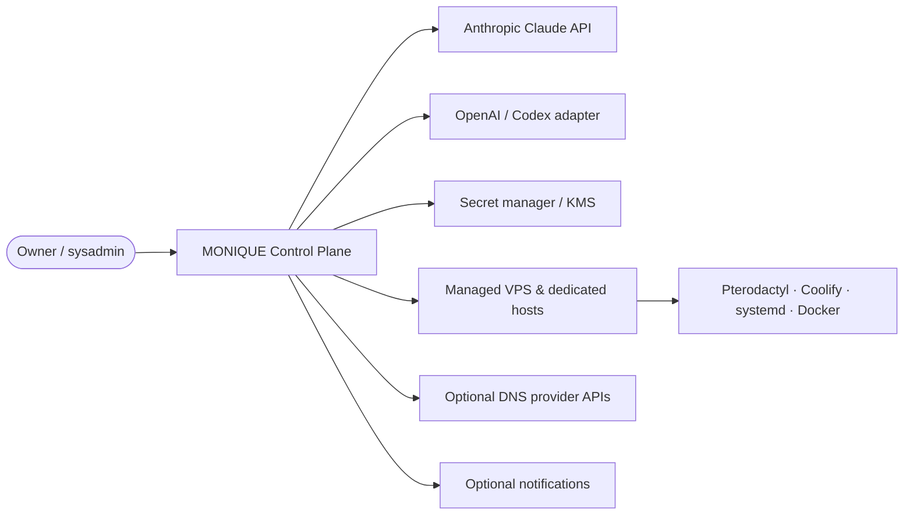
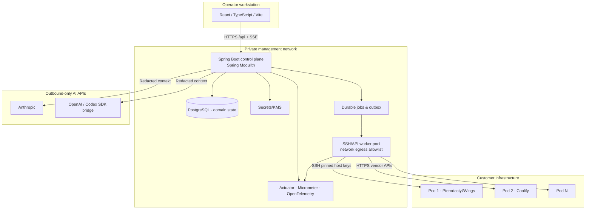

# System architecture

**Classification:** Target design, not implementation evidence. **Pattern:** Modular monolith for the control plane, independently deployable execution workers, externally managed hosts.

## System context

The trust boundary is between Monique's control plane and all third-party and remote responses. Remote command output, READMEs, package metadata, AI content and service API responses are **untrusted input**. No data from those sources may redefine operator authority.

## Container and deployment view

### Deployment principles

- Terminate TLS at a hardened reverse proxy. No direct public PostgreSQL, worker RPC, Actuator admin endpoint or SSH credentials API.
- Separate management network, identity and authorization context from each managed host. Isolate each worker's network access to assigned Pod endpoints.
- Do not mount a Docker socket inside the web/API container. The SSH or API worker has a scoped tool capability, not unconstrained host access.
- Application secrets live in a vault/KMS or encrypted store; PostgreSQL contains references/ciphertext, never raw SSH material.
- The MVP can use one database instance and isolated workers. Cross-process jobs must use a real durable queue/claim mechanism (not in-memory futures).
- Horizontal control-plane scaling is **deferred** until distributed locks and leasing are validated.

## Quality attributes and trade-offs

| Attribute | Target invariant | Verification |
|---|---|---|
| Safety | No protected-service modification without approved scoped plan | Negative tests + sandbox migrations |
| Auditability | Every step correlated to actor, plan, Pod and execution identity | Append-only audit tests |
| Durability | A process crash does not lose state of a job or silently re-run destructive steps | Worker crash fault injection |
| Security | Raw credentials never reach AI providers, logs or client responses | DLP / redaction assertions |
| Recoverability | Data backup is tested before destructive cutover | Restore drills, checksums and RPO report |
| Observability | Job progress and failed preconditions visible in real time | SSE integration tests |
| Extensibility | Add adapter without referencing other module internals | Spring Modulith verification |

**Non-goal for v1:** autonomous self-healing across production servers; orchestration of arbitrary root shell scripts; zero-downtime guarantees; built-in Kubernetes management; multi-region HA.

## Architecture constraints

**CQRS-lite:** reads may aggregate sanitized Pod inventories, while writes go through domain command handlers. Do not build full event sourcing for simple pod CRUD.

**Event-driven integration:** publish domain events after committing aggregate state. Use Spring Modulith's event publication registry for reliable in-process module events; use dedicated job persistence and leases for remote steps. Event publication registry alone is **not** a workflow engine.

**Network:** verify host fingerprint on first enrollment through an out-of-band trusted channel; block host key changes until reviewed. Never trust an address merely because the operator entered it.

**Idempotency:** each step declares whether it is safe to retry; use stable operation IDs, compare-before-write, and dedicated reconciliation paths.

## Integration ownership

The control plane owns plans and policy; execution adapters own API-specific operations; AI providers only produce structured proposed plans. Pterodactyl Panel operations use supported APIs where possible, Wings and OS-level changes use supported installation procedures and verified SSH; Coolify API operations are version-aware. Undocumented direct database edits are not a general integration strategy.

## Review checklist

- Does the change create an unapproved path from model output to infrastructure mutation?
- Does it expose or replay credentials outside the vault?
- Does it bypass module-owned repositories or package boundaries?
- Does it preserve traceability and rejection handling?
- Can an interrupted operation be resumed without duplicating destructive steps?
