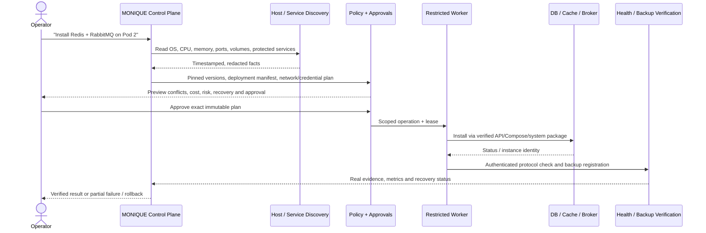
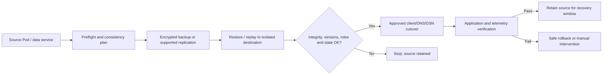

# MONIQUE Data Services & Messaging Architecture

**Document:** MON-DATA-001 · **Revision:** 1.0 · **2026-11-14**  
**Status:** Proposed engineering architecture, **not implemented**.

## Design principles

MONIQUE manages **stateful workloads**, which require stronger guarantees than installing stateless applications. PostgreSQL, MySQL/MariaDB, MongoDB, Redis/Valkey and RabbitMQ must have independent, version-aware adapters. Kafka, NATS and search/vector systems have different control and persistence semantics.

**A managed data service is not necessarily a Pod.** A `Pod` is an SSH-managed host. A `ConnectedAccount` is a provider identity, while a `DataServiceInstance` is a database, cache or broker associated with exactly one installation target (a Pod or managed provider resource). MONIQUE's own PostgreSQL metadata database is independent from the remote databases it manages.

## Planned supported families

| Family | Examples | Critical lifecycle distinction |
|---|---|---|
| Relational SQL | PostgreSQL, MySQL, MariaDB, TimescaleDB, CockroachDB, SQLite | Database roles, TLS, schema, replication and engine-specific backups; SQLite is an embedded file |
| Document / NoSQL | MongoDB, CouchDB, Cassandra, ScyllaDB | Auth, replica/cluster state, consistent backups and restore |
| Cache / key-value | Redis, Valkey, Dragonfly, Memcached, KeyDB | RAM ceilings, eviction policies, ACLs, durability; caches may intentionally discard data |
| Message brokers / streaming | **RabbitMQ / AMQP**, Kafka, Redpanda, NATS/JetStream, ActiveMQ Artemis, Pulsar, MQTT brokers | Queues, exchanges, topics, consumer state, acknowledgements, replication and retention |
| Search / analytics / vectors | OpenSearch, Elasticsearch, ClickHouse, Meilisearch, InfluxDB, Qdrant, Weaviate, Milvus | Index and collection compatibility, snapshots and capacity |
| Managed data services | Supabase, Neon, MongoDB Atlas, Upstash, Aiven, Redis Cloud, CloudAMQP, PlanetScale | Scoped provider APIs, region, account ownership and billing; **not root SSH** |

## Operator examples

- “Install PostgreSQL 17 on Pod 2; create an `orders` database and read/write role for my app, enable safe private connectivity and a tested backup.”
- “Install Redis on Pod 1 with a 512 MB memory budget, authenticated clients and explicit RDB/AOF durability.”
- “Install MongoDB Community on Pod 3 and create one least-privilege application user.”
- “Install RabbitMQ with AMQP/TLS, one virtual host, scoped user and a queue. Confirm that publishers and consumers can connect.”
- “Move MySQL from Pod 2 to Pod 3 and check application data after cutover.”
- “Migrate RabbitMQ from Pod 1 to Pod 2, including topology and a **separately planned message continuity strategy**.”
- “Diagnose why Kafka consumer lag or Redis eviction rate is increasing.”

These are **future target workflows**, not commands MONIQUE can execute today.

## Installation architecture

**Modes:** `DOCKER_COMPOSE` (pinned images and persistent volumes), `SYSTEM_PACKAGE` (signed vendor/OS repository, systemd), `EXISTING` (read-only discovery until approval), `MANAGED_SERVICE` (provider API, no SSH). Avoid arbitrary model-generated `curl | bash` root commands.

**Preflight:** distribution/kernel/architecture and repository support; data service major version and runtime compatibility; disk, inode, IOPS, CPU/RAM capacity; port and Docker network collision; existing services and ownership; backups/RPO/RTO; TLS; firewall; app secrets and protected Pterodactyl/Coolify resources. If checks fail, **no write operation** is performed.

**Postconditions:** authenticated service health, correct privileges, intended private listener, persistent volumes, capacity budget, test application connection, backup and restore plan, low-cardinality metrics and redacted audit evidence.

## Workload-specific backup and security

### PostgreSQL

Distinguish `pg_dump` (per-database logical export), cluster globals/roles, physical base backups, WAL archiving and point-in-time recovery. Choose a method based on RPO/RTO, size and compatibility, validate extensions, restore to an isolated target and perform real read/write checks. See [PostgreSQL backup documentation](https://www.postgresql.org/docs/current/backup.html).

### MySQL and MariaDB

Treat MySQL and MariaDB as separate engine/version families even if they share a network protocol. Inspect data directory ownership, user grants, `my.cnf`, InnoDB/binlog settings, collation/character sets and replica configuration. Logical dumps and physical backup tools require version-specific restore tests. Do not overwrite an existing data directory or expose port 3306 by default.

### Redis / Valkey

Decide between **CACHE_ONLY** (potentially disposable) and **DURABLE** (RDB/AOF persistence with recovery requirements) before installation. Set `maxmemory`, eviction policy, ACL, private bindings, authentication and appropriate TLS. Persistence can cause memory/IO pressure on shared game-hosting Pods. See [Redis persistence](https://redis.io/docs/latest/operate/oss_and_stack/management/persistence/).

### MongoDB

Install supported official packages or pinned containers, secure `bindIp`, enable authorization and least-privilege roles. Use `mongodump`/`mongorestore` only where they satisfy consistency requirements, and select replica/oplog-aware procedures for more complex workloads. Production destructive restore flags require separate approval. See [MongoDB packages](https://www.mongodb.com/docs/manual/administration/community-packages/).

### RabbitMQ and AMQP

**RabbitMQ offers separate control and data planes:**

| Interface | Default TCP port | Purpose |
|---|---|---|
| AMQP messaging | 5672 | Publisher/consumer connections |
| AMQP with TLS | 5671 | Encrypted messaging |
| Management HTTP API/UI | 15672 | Virtual hosts, exchanges, queues, users, bindings, monitoring |
| Prometheus plugin | 15692 | Metrics scraping where enabled |

Ports are typical defaults, not assumptions about a specific installation. The management HTTP API **cannot itself publish AMQP messages**. Monique needs a management adapter plus protocol-aware verification, with TLS and least-privilege credentials.

**Most important recovery distinction:** exporting RabbitMQ definitions captures exchanges/queues/vhosts/permissions/policies and similar configuration, **not queued message contents**. A broker migration must also plan consumer drains, in-flight message acknowledgement, publisher confirms, durable queues and compatibility of classic/quorum/stream queues. A successful definitions import is not a successful data migration.

See [RabbitMQ Management](https://www.rabbitmq.com/docs/management), [Definitions import/export](https://www.rabbitmq.com/docs/definitions) and [Networking](https://www.rabbitmq.com/docs/networking).

### Kafka, NATS/JetStream, MQTT, search/vector engines

These are **not AMQP clones**. Kafka uses partitions and consumer offsets, NATS/JetStream has subjects/streams/consumers, MQTT brokers have subscriptions and retained-message behavior, and search/vector engines have index/collection snapshots. Every adapter needs a separate compatibility and continuity test suite. Qdrant distributed collection snapshots, for example, are node-specific and not equivalent to single-node whole-storage snapshots. See [Qdrant snapshots](https://qdrant.tech/documentation/snapshots/).

## Cross-Pod migration lifecycle

Every snapshot needs checksum, encryption state, service version, storage target, creation time, retention and an independently verified restoration result. No automatic zero-downtime guarantees. Broker message continuity and database data integrity require **different** validation.

## Proposed Spring Modulith boundaries

| Module | Responsibility | Public contract |
|---|---|---|
| `dataservices` | SQL/NoSQL/cache instance metadata, plans, recovery evidence | `DataServiceDirectory`, `BackupEvidence` |
| `messaging` | Broker metadata, topology, queue/stream/consumer health | `BrokerDirectory`, `MessagingTopology` |
| `integrationcatalog` | Version- and credential-scope-aware capabilities | `CapabilityResolver`, `IntegrationDescriptor` |
| `workflows` | Immutable operation plan, approvals, durable job lifecycle | `JobCoordinator` |
| `policy` | Resource protection, required approvals and risk checks | `PolicyDecision` |
| `execution` | Dispatch only approved, scoped operations to isolated workers | `ExecutionGateway` |

**Managing RabbitMQ is not a reason to add Spring AMQP to the control plane**. Similarly, Spring Data Redis/MongoDB are needed only if MONIQUE itself uses those stores. External administration uses safe API/SSH workers. Enforce package boundaries with Spring Modulith tests before declaring implementation complete.

## Engineering acceptance criteria

- [ ] Discover existing services without mutating or exposing secrets.
- [ ] Verify supported OS, version, port, memory and disk constraints.
- [ ] Install PostgreSQL, MySQL/MariaDB, Redis/Valkey, MongoDB, RabbitMQ safely on disposable hosts.
- [ ] Never open database or broker listeners publicly by default.
- [ ] Generate least-privilege per-app credentials; never return secrets to models or ordinary logs.
- [ ] Test encrypted backups and **isolated restores**, not merely successful backup command exit codes.
- [ ] For RabbitMQ, test both topology and **queued-message continuity** independently.
- [ ] Verify resilience to crashed workers, incompatible versions, partial failure and stale monitoring.
- [ ] Prove protected Pterodactyl, Wings, Coolify and Docker resources remain untouched.

**Implementation state:** this document defines requirements and proposed interfaces. None of the remote installers/management adapters or safe execution workers is shipped by publishing it.
