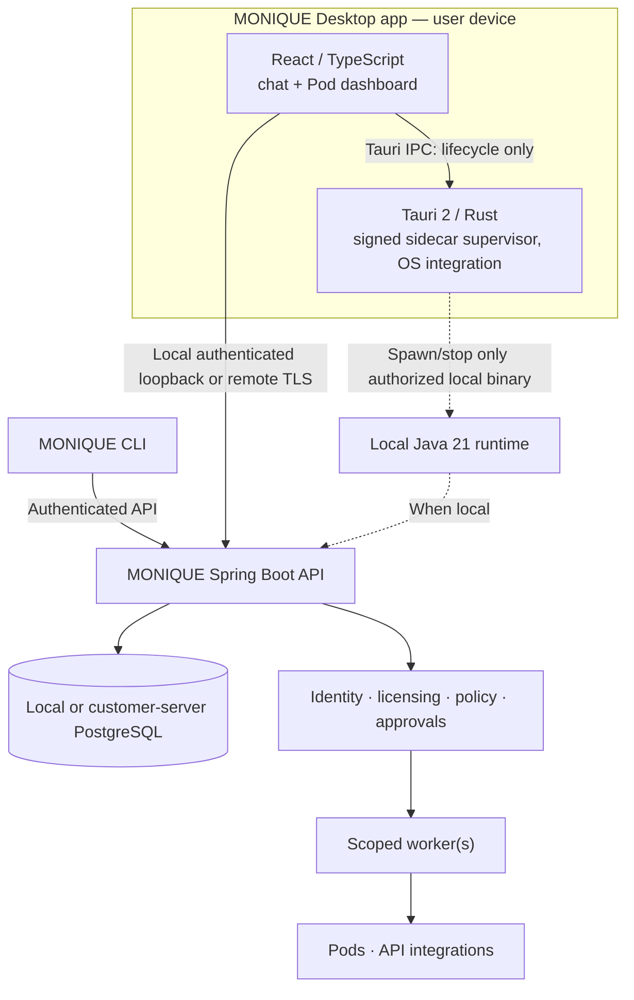

# MONIQUE Desktop — Tauri 2 / Rust + React architecture

**Document:** MON-DESKTOP-001 · **Revision 1.0** · **Date:** 2026-11-14  
**Status:** Target design / desktop application **not implemented**.

## User experience and goal

Create a Claude Code–style desktop application that runs on **Windows, macOS and Linux**, with a native window and an integrated AI conversation rather than requiring a terminal. It can be run **fully locally once packaging requirements are satisfied**, or act as an authenticated client to a customer-run MONIQUE server.

The desktop must manage the **same Pod resources, provider accounts, plans, approvals and jobs** as the CLI and React web dashboard. No desktop-only privileged remote executor.

### Main screens

| Screen | Planned features | Authority |
|---|---|---|
| **Chat** | Conversational command entry, streaming answer, target Pod selector, plan preview, logs, cancellation | All changes go through policy and approval |
| **Pods** | Add/edit/remove metadata, IPv4/IPv6, SSH identity/key enrollment, host fingerprint, connection testing | Secrets handled through secure backend flow |
| **Infrastructure** | Pterodactyl/Coolify, cloud providers, databases, Docker, Kubernetes, service health | Capability-limited read and approved operations |
| **Jobs & Approvals** | Queued/running/failed jobs, immutable plan diff, explicit approval and recovery status | Same job API as CLI |
| **Monitoring** | Prometheus/Grafana, optional Wazuh findings, Pod/worker health | Evidence and alerts only; cannot auto-authorize writes |
| **Membership** | Sign in/out, subscription/credits, active license, grace/expiration, billing portal | Only licensing/account details travel to Oreo |
| **Settings** | Local vs remote runtime, AI provider/BYOK, secrets, update status, network policy | Identity and vault enforcement required |

**Default onboarding:** (1) choose **Local MONIQUE** or **Connect to your server**, (2) sign in to Oreo Studios and verify membership as applicable, (3) select provider API/BYOK option, (4) add a test Pod using verified SSH host key, (5) run a read-only diagnostics chat, (6) preview a job/approval. Any step that requires unavailable implementation must show a clear disabled state, not simulate success.

## Desktop, CLI and core are peers, not wrappers around CLI output



**Avoid:** desktop launching a terminal then parsing `monique chat` text for critical state. CLI and Desktop should share **versioned JSON API contracts** (and SSE/websocket streams where justified). Common React components can be shared with the browser dashboard; never copy backend authorization into the UI.

## One-click desktop installation (target release experience)

**The customer must not manually install Java, PostgreSQL or an execution worker to use MONIQUE in supported local mode.** The Tauri installer will own a tested bundle/installation of the correct Java runtime, MONIQUE Core, isolated user-owned PostgreSQL, a restricted worker and local secret/IPC configuration, then verify actual readiness before enabling onboarding.

The desktop first-run wizard handles **Oreo Studios sign-in/membership**, AI provider credentials (BYOK or eligible credits), Pod enrollment with SSH host-key verification, then the first read-only chat. Installation of MONIQUE's dependencies must never silently modify the user's other database services, open a public listener or enroll unrelated hosts.

The first implementation milestone can remain **remote-client-only**, but the product's **local mode release gate is one-click dependency provisioning**. Tauri sidecar support alone does not package PostgreSQL, and claiming one-click local readiness is not allowed until cross-platform stateful storage, updates and recovery pass tests.

See [Installation & Onboarding](INSTALLATION-AND-ONBOARDING.md).

## Two runtime modes

### Mode A: connect to a MONIQUE self-hosted server (first desktop milestone)

The desktop stores a verified customer URL and a scoped authenticated session in OS-protected credential storage. It connects via HTTPS with a verified certificate, negotiates API version and discovers Pod status, chat, job history and membership. When closed, the server and workers continue. No local Java or PostgreSQL process is required in **remote client** mode.

### Mode B: launch MONIQUE locally (later full standalone milestone)

Tauri bundles or launches a **specific signed backend sidecar**, plus a suitable Java 21 runtime, via Rust-owned lifecycle commands. The local backend binds only to a user-scoped loopback endpoint or authenticated local IPC; use random per-session credentials and carefully enforce Origin/CORS/CSRF protections. Startup verifies the exact binary checksum/signature, detects whether a healthy instance is already running, establishes a safe local session, and watches readiness and exit status.

**Persistence blocker:** the current Spring backend uses **PostgreSQL**, not a portable embedded DB. A true one-click local mode must **explicitly solve** PostgreSQL provisioning/upgrade/backups (or an independently tested portable datastore alternative), with a migration and encryption-key plan. Never silently replace the database or claim Tauri alone makes the backend portable.

**Process lifecycle:** the app owns only a process that it started, not a system-wide service belonging to other users. Closing the desktop must clearly distinguish *disconnect* from *stop runtime*. A running critical migration must not be killed silently when a desktop window closes; require a persistent background service or a safe checkpoint before shutdown. Test interruption/restart/reconciliation.

## Tauri 2 security boundaries

Official Tauri v2 supports bundled **external binaries (sidecars)** and a capability-based permission model:

- [Tauri: embedding external binaries](https://v2.tauri.app/develop/sidecar/)
- [Tauri: capabilities and security boundaries](https://v2.tauri.app/security/capabilities/)
- [Tauri: shell plugin permission scoping](https://v2.tauri.app/plugin/shell/)

**Required rules:**

1. Rust's allowed IPC commands should be **`start_monique`**, **`stop_monique`**, **`runtime_status`**, **`select_verified_profile`**, and other narrowly scoped lifecycle/OS operations—not arbitrary shell, PowerShell or SSH.
2. Do not grant Tauri's WebView unrestricted `shell:allow-execute` or `fs:allow-*` access. Scope packaged sidecar binary and args through `src-tauri/capabilities`.
3. Chat output, rendered Markdown, remote host logs, vendor data and downloaded documents are **untrusted UI content**. Disable script injection and prevent unapproved external navigation.
4. OS Keychain/Windows Credential Manager/Linux secret service where supported stores access tokens; the backend vault stores SSH passwords/keys. Never persist tokens/credentials in frontend localStorage or telemetry.
5. Separate API membership verification from operator permission. React cannot decide when remote commands are allowed; the Spring server and workers enforce it.
6. Remote client TLS and local loopback/IPC must use different explicit connection profiles. No silent HTTP fallback for remote profiles.
7. Minimize outbound traffic from Tauri; allow needed Oreo licensing/login and AI provider connections only through the designed backend path.
8. Ship signed update artifacts, verify provenance, and preserve running jobs when updating the app/backend.

## Proposed repository layout (not created by this spec)

```text
apps/
  cli/                  # cross-platform terminal client
  desktop/
    src/                # React/TS app (chat, Pods, jobs, monitoring)
    src-tauri/
      src/              # Rust app + sidecar supervisor
      capabilities/     # explicit Tauri v2 permission scopes
      binaries/         # signed/versioned local runtime sidecar (when ready)
  web/                  # optional standalone browser app
packages/
  api-client/           # generated/versioned MONIQUE API types
  ui/                   # reusable React components
backend/                # existing Spring Boot API remains authoritative
services/
  licensing/            # future centrally hosted license service
```

This layout is a **roadmap**, not an assertion that files/directories already exist. The present repository's `backend` uses PostgreSQL; don't imply a desktop installer is currently available.

## Release and test gates

| Milestone | Deliverable | Verification |
|---|---|---|
| D1 | Tauri 2/Rust/React shell + secure remote profile | Build/test on Windows, macOS, Linux; no unrestricted IPC |
| D2 | Pod wizard + real API chat and job views | Auth, validation, stream retry, no secret leaks |
| D3 | Shared typed API/React UI library for desktop/web | Contract tests + security tests |
| D4 | Bundled local backend sidecar and Java runtime | Signed sidecar, safe lifecycle, readiness and startup tests |
| D5 | Local PostgreSQL strategy and safe migration | Storage portability, backups, encryption-key lifecycle |
| D6 | Subscription/account interface | Signed entitlement, offline grace, expiry-safe jobs |
| D7 | One-click desktop installers and updates | Windows NSIS/MSI, macOS signed/notarized bundles, Linux AppImage/deb/rpm; auto-provision/verify Core, Java, PostgreSQL and workers |

**Acceptance criteria:**
- [ ] User can chat with MONIQUE and manage Pods **without a separate terminal window**.
- [ ] CLI, Desktop and Web display the same job status and approval fingerprint.
- [ ] A compromised React view cannot invoke arbitrary shell/SSH through Tauri.
- [ ] Local backend never binds to a public interface by default.
- [ ] Remote mode uses TLS and cannot downgrade to plain HTTP.
- [ ] Local mode automatically provisions database, Java, vault and worker on first installation without manual dependency setup; lifecycle survives app restart.
- [ ] Closing Desktop never silently abandons a partially completed migration.
- [ ] License expiry preserves read-only/recovery/export functionality.
- [ ] All release platforms and signed update paths tested.

**Status:** this is an architecture specification; no built desktop app or installer has been produced or released.
