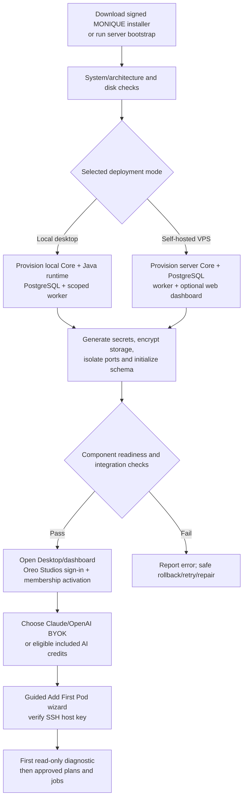
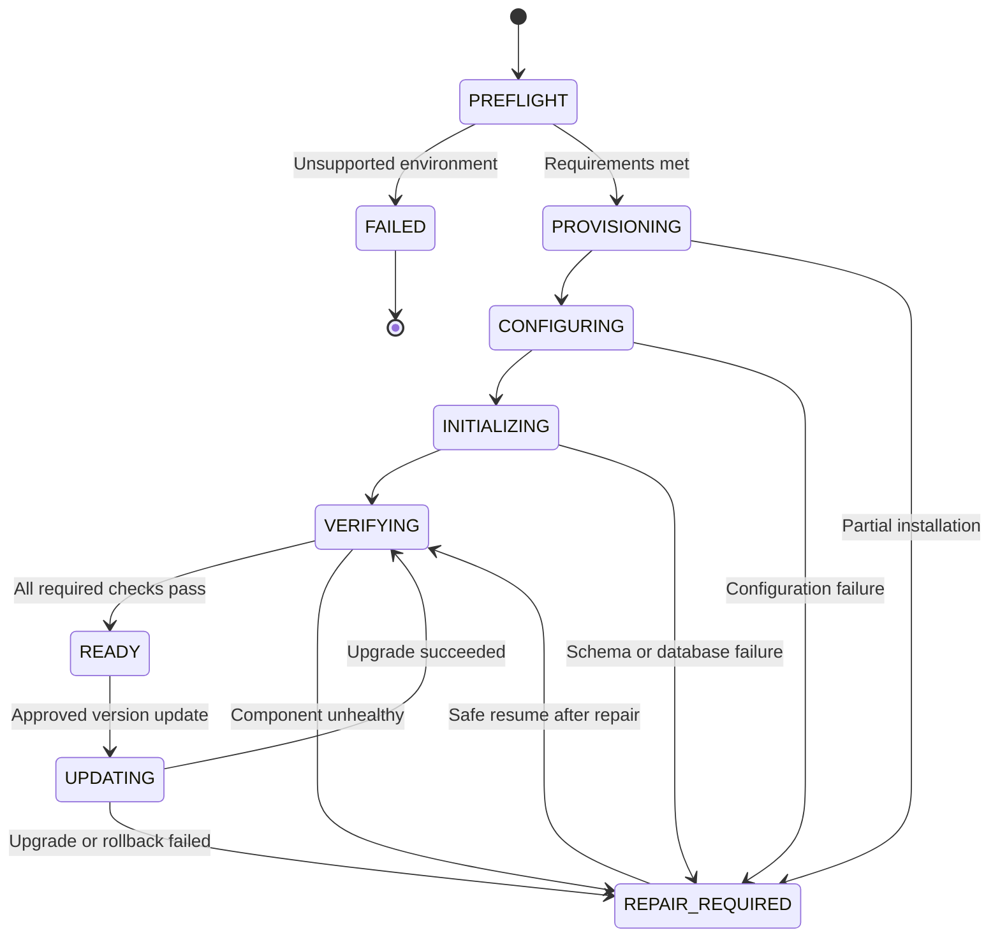

# Installation & first-run onboarding — MONIQUE

**Document ID:** MON-INSTALL-001 · **Revision:** 1.0 · **Date:** 2026-11-14  
**Status:** **Target product experience. Automatic installers, licensing activation and local packaged runtime are not yet implemented.**

## Non-negotiable product promise

**One customer installation; automatically provision and configure the internal components.**

Customers should **not** need to download Java, configure PostgreSQL by hand, deploy an execution-worker microservice, manage internal ports, run SQL schema files or manually assemble Spring Boot containers to get started. Those are **implementation details**, even if the runtime contains several independent processes.

**Internal deployment topology is not the customer-facing number of installation steps.** The bundled product may install a Spring Boot/Spring Modulith Core, PostgreSQL, narrowly scoped worker process, optional dashboard and supporting certificates/keys; the customer launches **one installer or one documented server bootstrap workflow**.

The installer must not promise compatibility with every operating system or machine. If prerequisites cannot be handled safely and automatically (privileged package installation, virtualization/container support, system policy, database storage or service registration), show a precise blocker and a supported recovery path. No silent OS security policy bypass.

## First-run customer journey

**Customer-visible result:** **Download → Install → Sign in → Configure AI → Add a Pod → Talk to MONIQUE.** No manual Java/database/worker setup in the supported normal path. Membership verification and Pod enrollment occur **after infrastructure readiness**, so a failed purchase/login does not leave a broken installation.

## Mode A — local Tauri desktop installer

A **Tauri 2/Rust + React** signed installer for Windows, macOS or supported Linux distributions orchestrates the following actions with an explicit UI and verification:

| Phase | Installer responsibility | Failure/safety behavior |
|---|---|---|
| 1. Compatibility | CPU architecture, supported OS release, disk/free space, existing installations, required ports, user permissions | No modification on unsupported platform; precise diagnostics |
| 2. Binaries | Install app, known-version Core and appropriate Java runtime; verify hashes/signatures | No untrusted download or arbitrary script execution |
| 3. PostgreSQL | Safely initialize **customer-owned local PostgreSQL** with isolated data directory, database role, backups and migration strategy | Do not overwrite an existing PostgreSQL instance or use its admin password without consent |
| 4. Worker | Install a restricted, version-compatible worker with minimum OS permissions | No default persistent root service; elevated rights only for an approved step |
| 5. Configuration | Choose user-scoped storage, generate encryption keys, file permissions, loopback/IPC credentials and local endpoint | Local-only transport; no public listeners |
| 6. Initialization | Apply checked schema migrations, seed minimal safe state and verify Core/DB/worker health | Abort without declaring success; preserve diagnostic and recovery state |
| 7. First-run wizard | Open MONIQUE, sign in/activate subscription, configure AI and enroll first Pod through trusted host-key verification | No implicit cloud purchases, Pod changes or SSH credential upload to Oreo Studios |

**Tauri acts as a UI and supervised process launcher, not a duplicate infrastructure management backend.** It may start the approved local Core, but cannot expose arbitrary PowerShell or shell execution to webview/AI.

**Important blocker today:** the current backend uses **PostgreSQL**. Packaging a secure local PostgreSQL lifecycle (or separately designing and verifying an alternate portable persistence option) is mandatory before advertising a standalone one-click desktop product. Bundling Tauri alone does not solve it.

**Startup after installation:** Monique detects its existing local runtime, starts/reconnects to the correct user-owned components, checks service health and only then opens interactive chat. Multiple desktop windows must not spawn duplicate database or worker instances.

## Mode B — one bootstrap for a customer-owned server

For a supported Linux VPS/dedicated host, an operator uses a **single guided installer or verified bootstrap command**. The installer can select a pinned, reviewed container stack and automatically create:

- MONIQUE Spring Boot Core / Spring Modulith, with isolated configuration and secrets.
- PostgreSQL with persistent customer-owned volumes, credentials and backup policy.
- Restricted execution-worker container/process and durable job storage.
- Web dashboard and authenticated HTTPS entry point, where selected and domain/TLS conditions are satisfied.
- Health checks, startup policies, monitoring hooks and protected update/repair paths.

**Prerequisite detection:** if Docker/Compose or another container runtime is missing, offer an **explicitly approved** supported automated bootstrap path where safe, rather than claiming Docker is always available. If system privileges, firewall, DNS or certificates require external action, stop with clear instructions and retain a resumable setup state. Never execute unknown third-party scripts as root.

**No implicit managed-Pod enrollment:** the server hosting MONIQUE is not automatically registered as a target for AI maintenance. Adding a separate Pod is an explicit operator choice, including if it is the same physical host.

Remote Desktop/CLI connect to the installed server over authenticated TLS; **they do not install another backend or PostgreSQL** on the operator's laptop in remote-client mode. Server-side approved jobs continue after the browser or desktop app closes.

## Deployment manifest and lifecycle contract (proposed)

Treat the installer as a small **declarative orchestrator** with versioned component metadata, desired versions, allowed changes, prerequisites and postcondition checks. Its setup state machine is:

**Critical invariant:** an installer reporting success means a real Core health check, actual PostgreSQL connectivity/schema readiness, a version-compatible registered worker, and an authenticated local/browser client. A process merely being present or a container running does **not** prove readiness.

On failure, record sanitized logs and a component-specific diagnostic. Do not delete existing data or credentials by default. Restart/resume must be idempotent. Never retry destructive schema migrations blindly.

## Configuration, security and memberships

- Use user-scoped installation where practical; prompt for elevation **only if necessary** and show the concrete operation.
- Do not expose PostgreSQL, Java Actuator admin endpoints, workers or local control-plane API to the public Internet. Remote HTTPS is explicitly configured and secured.
- Generate unique credentials/key material. Secrets live in protected local storage / secret manager, not in terminal commands, installer logs, plaintext configuration, or the central licensing service.
- Sign and checksum binaries and release manifests; verify provenance before executing an update or sidecar.
- If MONIQUE subscription is expired, preserve read-only access, exports and safe recovery. Do not kill a running approved migration because of licensing or billing.
- Updates require backups and schema compatibility checks; do not silently change a worker or database version mid-job.
- Uninstall must clearly distinguish **remove application binaries** from **delete databases, backups, managed servers or secrets**. Default to preserving user-owned data.
- Remote Pods remain owned and controlled by the customer. Automatic bootstrap applies **only to MONIQUE's own internal dependencies**, not to third-party hosts.

## Signed, optionally obfuscated application payloads (target)

The **customer installer never runs OreoObfuscator**. Release CI builds and tests MONIQUE Core, applies OreoObfuscator to compatible Java-owned classes, then signs the verified binary and bundles it with Java runtime, PostgreSQL and restricted worker components. The installer verifies signatures/checksums before execution.

The final packaged application must preserve Spring Boot startup, module boundaries, DB migrations and licensing/approval behavior after transformation. `mapping.json` is retained **privately**, not inside installer archives. Java obfuscation does not protect Rust/React; those use their own signed/provenance-checked release assets.

**Not implemented yet.** See [Release Protection](RELEASE-PROTECTION.md).

## Completion and release tests

- [ ] Clean Windows install launches a real desktop, Core, PostgreSQL and worker without manual Java/SQL steps.
- [ ] Clean macOS install supports compatible signed/notarized distribution and user-scoped state.
- [ ] Clean Linux install works on explicitly supported distro/architecture combinations.
- [ ] Customer-owned VPS server bootstrap automatically provisions its reviewed stack, dashboard and health checks.
- [ ] Existing PostgreSQL/database containers remain untouched if they do not belong to this installation.
- [ ] Partial setup, lost connectivity, process crash and permission denied states are resumable and diagnosed accurately.
- [ ] A second run does not create duplicate databases/workers or reinitialize encrypted secrets.
- [ ] Loopback endpoints and remote HTTPS are independently tested against unauthorized access.
- [ ] Login, membership activation, AI provider selection and first Pod wizard operate after readiness checks.
- [ ] Worker crash/restart and application close never silently abandon an approved destructive job.
- [ ] Signed updates back up state and preserve schema/workflow compatibility; uninstaller leaves owned data intact by default.
- [ ] No 24/7 microservice administration or manual Docker/JVM/PostgreSQL setup is required **for a normal supported installation**.

**Status reminder:** this is a release contract, not evidence that one-click installation currently works.

Related: [Desktop](DESKTOP-APP.md), [Self-hosting & CLI](SELF-HOSTING-AND-CLI.md), [Development](DEVELOPMENT.md), [Security](SECURITY.md), [ADR 0006](adr/0006-one-install-managed-components.md).
