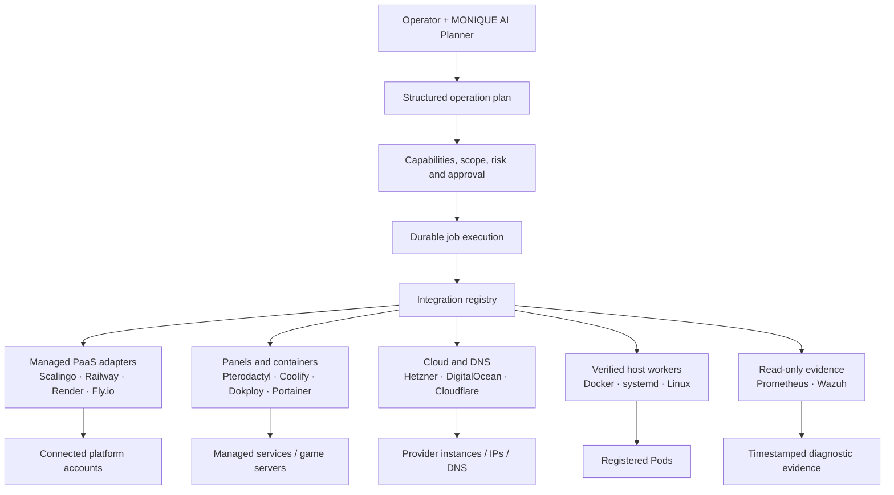
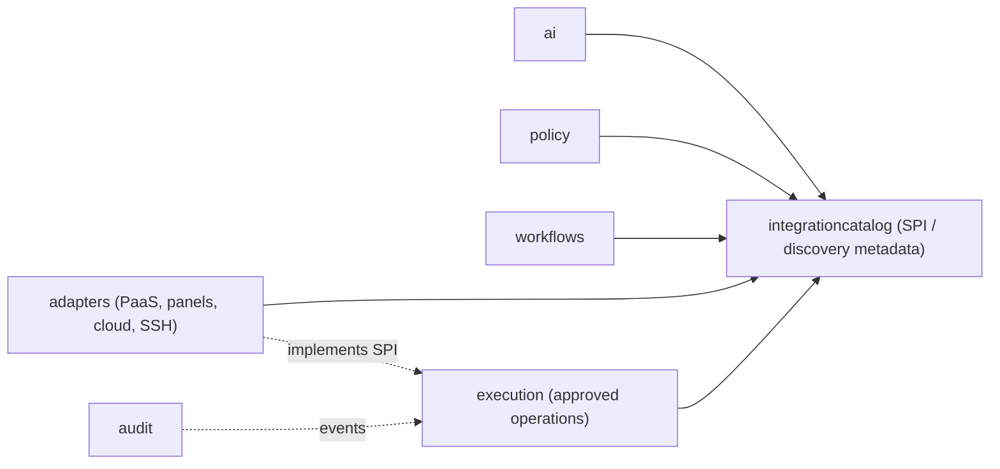
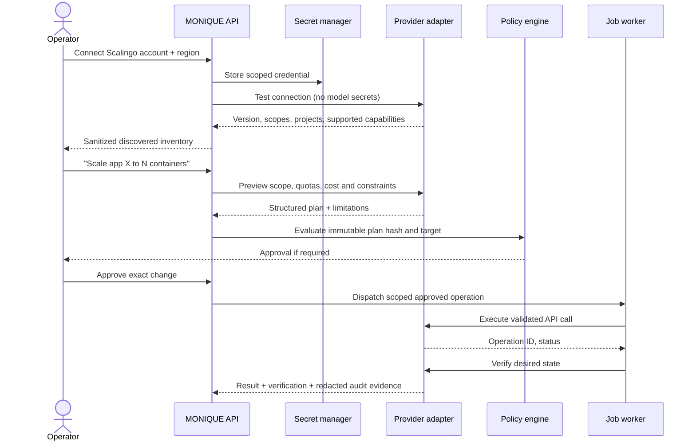
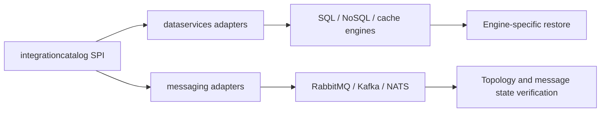

# Integration architecture — adapters, capabilities and safety

**ID:** MON-INT-ARCH-001 · **Status:** target design; **not current implementation**.

## Why a provider-aware adapter layer

A managed PaaS like Scalingo, a container panel like Coolify, a game server panel like Pterodactyl and a provider like Hetzner solve **different problems**. Monique should not treat them as interchangeable SSH targets. A provider-aware domain prevents broad root access, false success claims and migrations that silently discard persistent state.



## Domain objects

| Object | Identifier | Owns | Example |
|---|---|---|---|
| `Pod` | `podId` | Host endpoint, verified host key, addresses and OS inventory | Pod 1, SSH reachable |
| `ConnectedAccount` | `accountId` | Provider, region, base endpoint allowlist, token/secret reference, permissions | Scalingo account in `osc-fr1` |
| `IntegrationInstallation` | `installationId` | Installed panel+version, base URL, instance scope, API credentials reference | Coolify on Pod 1 |
| `RemoteResource` | `resourceId` | Provider resource ID, kind, state, parent, observed timestamp, relationships | Railway service, Scalingo app |
| `Capability` | stable name | Required scopes, risk, supported version, read/write distinction | `app.deploy`, `vm.snapshot` |
| `OperationPlan` | immutable `planId` / digest | Target resources, sequence, preconditions, approvals, recovery | migrate service |
| `ExecutionEvidence` | job/step ID | Redacted request/response summary, actual state checks | verified deployment URL |

**Ownership matters:** deleting a ConnectedAccount should disconnect credential access, not destroy the underlying cloud resources. Removing a Pod inventory record must not delete or stop the remote machine. Separating installation from host allows one host with both Pterodactyl and Coolify or a hosted external API with no Pod.

## Adapter contracts — logical Java interfaces (NOT committed code)

```java
public interface IntegrationProvider {
    IntegrationDescriptor descriptor();   // kind, version, capabilities
    ConnectionResult testConnection(ConnectionContext context);
    List<RemoteResource> discover(ResourceQuery query, ConnectionContext context);
}

public interface PlannedOperationProvider {
    OperationPreview preview(ScopedAction action, EvidenceContext evidence);
    // Only execution worker invokes after approval validation:
    OperationResult execute(ApprovedOperation operation, WorkerContext worker);
    VerificationResult verify(OperationResult result, VerificationSpec spec);
}

public record IntegrationDescriptor(
    String id, Set<String> supportedVersions,
    Set<Capability> capabilities, Set<String> requiredScopes
) {}
```

This contract is illustrative and must not be mistaken for already-tested Java source. Discovery methods must not expose credentials or return arbitrary vendor payloads to the model.

Capabilities are explicit (e.g., `host.inspect`, `app.list`, `app.deploy`, `server.create`, `database.backup`, `dns.record.update`, `vm.snapshot`, `metrics.query`). **Do not implement generic "execute anything" capabilities.** Every write capability has a risk class, required scope, precondition and postcondition contract.

## Spring Modulith package ownership

Introduce **`integrations` as registry/catalog domain** exposing only interfaces and immutable DTOs, plus versioned adapters under `integrations.internal.<provider>`. These are **internal packages**, not independent Spring Modulith modules, unless scale and delivery isolation later justify splitting. If module boundaries require separation, model `integrationcatalog` (public SPI) and `adapters` (implementation) as different module roots; `execution` depends on the SPI, never imports the internal provider classes.



Solid arrows express **compile-time dependencies**; dotted arrows express runtime implementation/event relationships only. Provider drivers are selected by the registry; they cannot bypass the policy job gateway, and a provider's `hasCapability` must be checked against actual version and token scopes.

## Onboarding and workflows



### Error and risk rules

- Provider credentials are encrypted/vault-backed and **never** sent to Claude/Codex. Per-provider connection endpoints are allowlisted; reject non-HTTPS SaaS API URLs and private-address SSRF unless explicitly trusted in private mode.
- Require **correct privilege scopes and region/tenant**: a token that can list resources may not deploy, scale or delete them.
- Handle `401`/`403`, `429` with `Retry-After`, asynchronous provider operations, eventual consistency and partial success. For **Railway GraphQL**, inspect `errors` even if HTTP status is 200.
- Never retry destructive actions without provider idempotency semantics. Store operation identifiers and reconcile remote state before resuming.
- Plan preview lists **resource identity, change, expected impact, costs, backup/recovery options**, and the required approval.
- Protect services already present on a destination. DNS, firewall, public IP, backup deletion, cluster reconfiguration and root access are **high-risk writes**.
- Missing capability, missing permission, mismatched version or quota must produce a **typed blocking error**, not a shell fallback.
- Avoid exposing raw Docker daemon socket or Kubernetes cluster-admin credentials to the Spring HTTP/API process.
- No one-click cross-provider "full migration" promise: use workload manifests + database snapshot + object/volume transfer + secrets mapping + cutover + rollback; preserve provider-specific semantics.

## Database and broker adapters

The integration registry exposes **per-engine** capabilities such as `discover`, `install`, `configure`, `create_database`, `create_user`, `backup`, `restore`, `migrate`, `monitor`, `queue.manage`, and `topic.manage`. These are not universal; missing support must return `UNSUPPORTED`.



RabbitMQ uses **two independent interfaces**: management HTTP API for administration, and AMQP for publish/consume. A successful management API operation does not demonstrate data-plane availability or queue payload continuity. Provider credentials remain in the vault; worker execution requires an approved operation ID, scope and immutable plan digest.

See [DATA-SERVICES.md](DATA-SERVICES.md).


## Implementation verification

Contract test suite for every adapter:
- read-only credentials can discover but cannot mutate;
- unrecognized API version / missing scope returns unsupported;
- pagination, rate limiting and partial failures are handled;
- connection tokens/logged data are redacted;
- approval tied to the exact resource/plan digest is mandatory for writes;
- transfer validation detects incompatibilities, stale health metrics and missing data;
- idempotent retries pass; destructive retries are blocked;
- disable/remove connector never removes a remote provider resource.

**Shipping rule:** documentation catalog entries remain `ROADMAP_NOT_IMPLEMENTED` until CI and sandbox evidence prove the adapter is safe.

See [Catalog](INTEGRATIONS.md), [Security](SECURITY.md), [Spring Modulith](SPRING-MODULITH.md), [ADR 0002](adr/0002-provider-integration-model.md).
