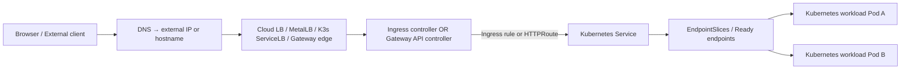
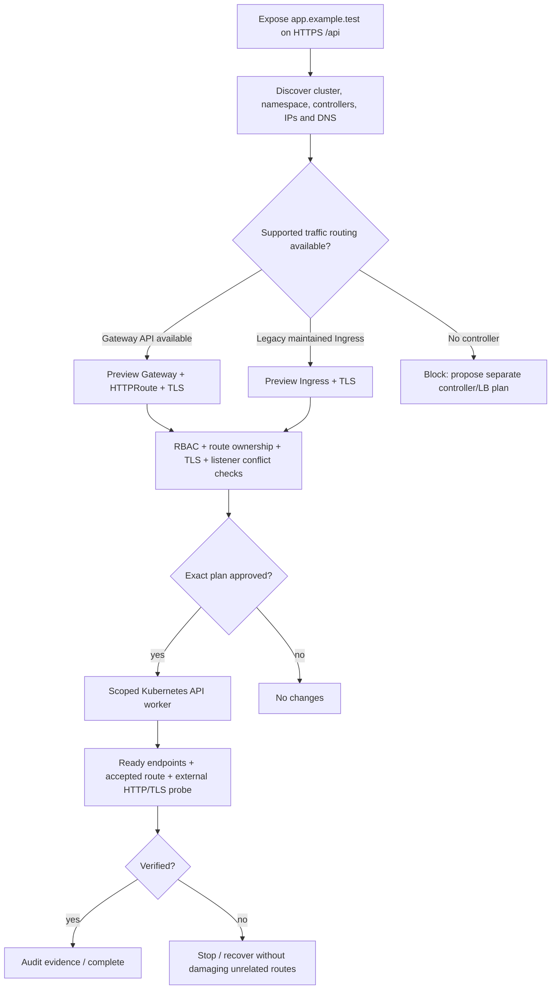

# Kubernetes Services, Ingress & Gateway API

**Document:** MON-K8S-NET-001 · **Revision:** 1.0 · **Date:** 2026-11-14  
**Status:** Target architecture only. **No Kubernetes controller, API adapter, ingress installer or Gateway API integration has been implemented in MONIQUE.**

## Terminology and identity boundaries

**Critical:** MONIQUE's existing user-facing "Pod" means **a registered VPS / dedicated server**. Kubernetes has a *different* resource also called **Pod**, representing one or more scheduled containers.

| MONIQUE resource | Kubernetes equivalent / relationship |
|---|---|
| `Pod` / future `ManagedHost` | An independently managed VPS/dedicated server; optionally runs a Kubernetes Node or control-plane |
| `KubernetesCluster` | A separately connected API server and scoped Kubernetes credential |
| `KubernetesNode` | Registered cluster node; may correlate to a MONIQUE managed host |
| `KubernetesWorkloadPod` | Native Kubernetes namespaced Pod; ephemeral IP; **not** a MONIQUE managed host |
| `KubernetesService` | Stable virtual service entry point or DNS alias backed by endpoints |
| `Ingress` | Namespaced L7 HTTP(S) routing rules; requires a working Ingress controller |
| `Gateway` / `HTTPRoute` | Gateway API routing resources; require installed API CRDs and compatible controller |

Registering a Kubernetes cluster is separate from enrolling hosts by SSH. A kubeconfig or service-account credential must be tightly scoped, stored in a vault, and never passed to Claude or Codex. MONIQUE must not silently use a cluster-admin kubeconfig.

## Kubernetes Service types (planned read/preview/create/update/delete)

| Type | Behavior | MONIQUE's required preflight |
|---|---|---|
| `ClusterIP` (default) | Stable **cluster-internal** virtual IP and DNS entry; optionally headless with `clusterIP: None` | Target namespace, endpoint readiness, selector, service port and DNS policy |
| `NodePort` | Exposes node IPs on a port chosen from a configurable range (default **30000–32767**) | Range availability, service reachability, node firewall, source policy, ownership of port |
| `LoadBalancer` | Requests an external LB through a cloud or bare-metal implementation; may remain Pending without one | Detect provider/LB controller, cost, IP allocation/announcement, externalTrafficPolicy, health checks |
| `ExternalName` | DNS CNAME to an outside hostname; **does not proxy traffic or use a selector** | Validate hostname, DNS and TLS behavior, no SSRF or arbitrary internal DNS targeting |

Service selectors/endpoints and EndpointSlices should be inspected. A running Pod is **not** proof that a Service has a healthy ready endpoint. Monitor `status.loadBalancer.ingress`, DNS, readiness probes, route/controller status and externally observable traffic before declaring an operation successful.

A `LoadBalancer` on bare-metal Kubernetes does **not** automatically obtain a public IP. Depending on the cluster, a provider CCM, MetalLB or another LB implementation may be required. NodePort exposure is not inherently safe for production.

## Ingress and Gateway API: separate objects

Ingress is a Kubernetes **API object**, not a controller. Creating it without a supported running controller does not guarantee traffic routing. The Ingress API is frozen; Kubernetes now recommends **Gateway API** for new features. Gateway API has `GatewayClass`, `Gateway`, `HTTPRoute` and `GRPCRoute` and needs matching CRDs plus a controller. Some route kinds such as `TCPRoute`/`UDPRoute` are experimental and must be capability-gated rather than assumed universally available.

**2026 security decision:** the community **ingress-nginx controller** was retired on **2026-03-24**; it receives no further security fixes. MONIQUE should detect and report legacy installations and offer a reviewed migration path—not automatically install retired ingress-nginx on a new cluster. **NGINX the web server and NGINX Gateway Fabric are separate products**, and should not be conflated with the retired ingress-nginx project.

Potential maintained controller paths (version- and capability-checked): Traefik; Gateway API implementations such as Envoy Gateway; NGINX Gateway Fabric; and other currently maintained compatible implementations. **MONIQUE must verify actual controller support, not infer it from a resource type alone.**

## K3s-specific networking (mandatory compatibility detection)

K3s often packages **CoreDNS**, **Traefik**, **ServiceLB**, and a NetworkPolicy controller. **Do not assume they remain enabled** on a particular cluster. The default Traefik LoadBalancer deployment can occupy **ports 80 and 443** through ServiceLB across nodes. This matters if a MONIQUE managed host already runs Coolify, Pterodactyl, nginx or another listener on those ports.

- Detect enabled **Traefik**, **ServiceLB**, DNS, CNI and network policy implementation first.
- Detect existing hostPort/hostNetwork and L4/L7 edge listeners, node IPs and collisions.
- K3s ServiceLB can use node addresses for LoadBalancer status, not necessarily a newly provisioned external cloud LB; verify public reachability independently.
- If using MetalLB instead of ServiceLB, require a deliberate integration plan and IP address ownership/announcement checks.
- K3s Traefik Helm chart changes can invalidate old configuration values across upgrades; pin chart/runtime compatibility and do not edit generated packaged manifests directly.
- Gateway API must be installed and supported by the selected controller; K3s deployment alone does not guarantee working Gateway resources.

Source: [K3s networking services](https://docs.k3s.io/networking/networking-services).

## Security and execution constraints

1. **RBAC first:** minimum namespace-scoped verbs/resources; no automatic cluster-admin, no pod `exec`, no reading Kubernetes Secrets into AI context.
2. **No implicit cluster writes:** AI proposes a declarative structured diff and a typed capability; policy validates namespace, identity, controller capability, network exposure, cost and impact.
3. **Never leak kubeconfig tokens or Secrets** to models, logs, dashboards, health metrics or CI artifacts.
4. **Server-side dry-run** for valid manifests when supported, plus diff, preconditions and change approval before applying a resource; dry-run is not sufficient as proof of dataplane reachability.
5. **Cross-namespace routing** needs explicit Gateway `allowedRoutes` and/or `ReferenceGrant` as appropriate. Forbid unreviewed privilege boundary changes.
6. **NetworkPolicy** requires a capable CNI; creating a resource alone may not enforce isolation. Do not claim a network is protected until enforcement is validated.
7. **Public exposure** is a high-impact change: DNS, TLS certificates, external IP, firewall, LoadBalancer cost and traffic cutover require approval and verification.
8. **Controller status** (`Accepted`, `Programmed`, `ResolvedRefs` where supported), EndpointSlices, readiness and real HTTP(S) probes are required for a "working" result.
9. **No broad deletion** of shared GatewayClass, cluster-scoped load balancer infrastructure, common DNS or existing route resources because one app failed.

## Target module and API design

Add a **`kubernetes` Spring Modulith management bounded context**, with public read-only resources such as `ClusterDirectory`, `ServiceInventory`, `GatewayCapabilities`, `RouteHealth`, `KubernetesOperationPreview`. Separate the concepts `ManagedHost` and `KubernetesWorkloadPod` in all DTOs and APIs.

The Kubernetes Java client belongs in a **version-compatible scoped integration worker**, while a control-plane service may retain only sanitized inventory and immutable previews. `workflows` owns plans; `policy` authorizes; `execution` invokes a restricted client. No direct model-generated arbitrary Kubernetes YAML application.

**Suggested phased delivery:**

- K0 — **Read-only** cluster discovery, namespace, Service/EndpointSlice, Ingress, Gateway, controller and LB inventories
- K1 — Service previews + controlled create/update for ClusterIP and ExternalName
- K2 — high-risk NodePort/LoadBalancer plans with IP/firewall/provider checks
- K3 — read-only Ingress and Gateway discovery, controller capability negotiation and drift detection
- K4 — approved Ingress/Gateway API routing/TLS with dry-run, real traffic verification, DNS coordination
- K5 — installation/upgrade of suitable controllers only after sandbox compatibility tests; K3s/MetalLB migration runbooks

**Current status:** roadmap only; there are no implemented Kubernetes client, controller, service, Ingress or Gateway execution adapters in this repository.

## Official references

- [Kubernetes Services](https://kubernetes.io/docs/concepts/services-networking/service/)
- [Kubernetes Ingress](https://kubernetes.io/docs/concepts/services-networking/ingress/)
- [Gateway API](https://kubernetes.io/docs/concepts/services-networking/gateway/)
- [Gateway resource model](https://gateway-api.sigs.k8s.io/docs/concepts/api-overview/)
- [Kubernetes NetworkPolicy](https://kubernetes.io/docs/concepts/services-networking/network-policies/)
- [K3s Networking Services](https://docs.k3s.io/networking/networking-services)
- [Ingress NGINX retirement](https://kubernetes.io/blog/2026/01/29/ingress-nginx-statement/)
