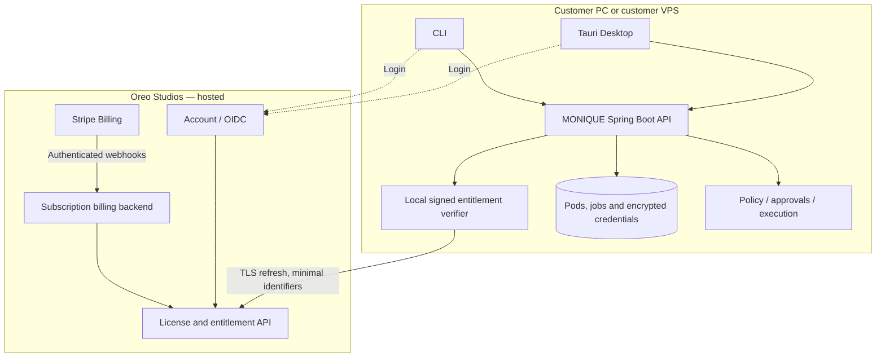
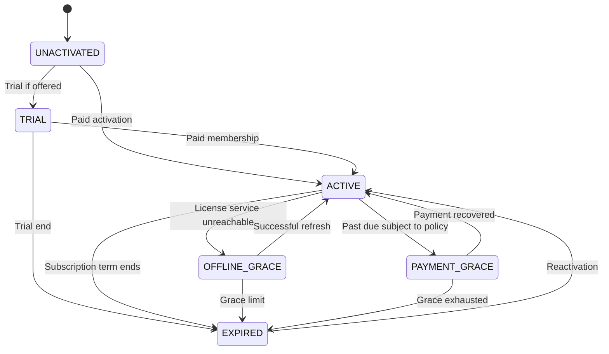

# MONIQUE membership, licensing and billing architecture

**Document:** MON-LIC-001 · 2026-11-14 · **Status: proposed; not implemented**

## Intent

MONIQUE is planned as a **self-hosted paid product**. A customer can run its server, CLI and desktop on their own computer or VPS, yet must maintain a **monthly MONIQUE membership** to start premium AI and infrastructure automation jobs. The self-hosted system retains customer Pod credentials, local state, approvals and secret store. Only account identity, entitlement status and minimal installation/version metadata go to Oreo Studios licensing.

**Commercial decisions not final:** subscription prices, trial/free tier, installation/device count, AI credit quotas, grace policy and licensing terms. A restrictive license must be chosen and reviewed before release. Publishing the application under a license that grants unrestricted use would make a mandatory paid-use restriction legally incompatible.

## Central services versus customer runtime

The desktop or customer-run backend **must never contain Stripe secret keys or webhook signing secrets**. The central server alone verifies billing events and signs entitlements; customer runtimes contain only public verification keys. Avoid sending IP inventories, SSH private keys, terminal history, prompts or database contents to the licensing service.

## Entitlement model and checks

Suggested fields (versioned and signed): `licenseId`, `product`, `subjectAccountId`, `installationId`, `issuedAt`, `notBefore`, `expiresAt`, `featureFlags`, `quotaLimits`, `signatureKeyId`. Do not put personally sensitive customer metadata inside unsigned tokens. Online revalidation may check revoked/expired entitlements; offline caches cannot provide instant revocation.

**Proposed offline policy:** short-lived verified entitlements and **up to 7 days of offline grace** for a previously activated installation; exact rule TBD. Clock rollback, stolen device, revoked subscription, invalid signature, device reactivation and multi-installation entitlement counts need explicit tests.

**On expiration:** block **new premium jobs and paid AI queries**, not read-only inventory, safe export/backup, emergency rollback or already-approved in-progress migration checkpoints. The billing server cannot issue direct SSH instructions and may not terminate critical tasks.

**Policy composition:** `AllowedAction = ValidMembershipEntitlement AND OperatorPermission AND TargetCapability AND ValidApprovedPlan AND SafePreconditions`. None of these factors substitutes for the others.

## Local binary obfuscation (target)

MONIQUE's local signed-entitlement verifier may be protected with **OreoObfuscator in production Java releases** to discourage casual patching. This does **not** make a customer-controlled self-hosted binary uncrackable: a determined user can modify the verifier or program logic. Keep private entitlement signing keys and billing authorization exclusively on Oreo Studios servers, and re-authorize every paid hosted-AI request server-side.

OreoObfuscator's internal `oreo-licensing` is a **separate** product/tooling entitlement, not MONIQUE's monthly customer membership. Test signed-license expiry, failed online refresh, bounded offline grace and recovery behavior against the obfuscated final artifact.

See [Release Protection](RELEASE-PROTECTION.md).

## AI provider billing

- **BYOK:** users configure supported provider API keys locally; their provider usage is billed to them separately from MONIQUE membership.
- **Included credits:** Oreo Studios operates a metered AI gateway, enforces quotas and protects the customer's operational data; this requires explicit privacy terms and provider contracts.
- Do not treat Claude Code/ChatGPT consumer app subscriptions or copied cookies/OAuth sessions as reusable API entitlements for MONIQUE.

## Acceptance checks

- [ ] A membership can activate a self-hosted installation through the central account service.
- [ ] Signed license tokens cannot be forged or altered; local client never contains signing key.
- [ ] Offline/outage grace works but does not become a permanent unrestricted license.
- [ ] New premium operations are blocked after expiry; own-data exports and safe recovery remain.
- [ ] In-flight long-running jobs complete or reach a safe reconciliation state during expiry/outage.
- [ ] Billing webhook duplication, out-of-order events, cancellations, payment retries and tenant limits tested.
- [ ] Source and license terms reviewed before claiming mandatory monthly paid access.

See [Self-hosting](SELF-HOSTING-AND-CLI.md), [Desktop](DESKTOP-APP.md), [ADR 0004](adr/0004-self-hosted-cli-membership.md).
