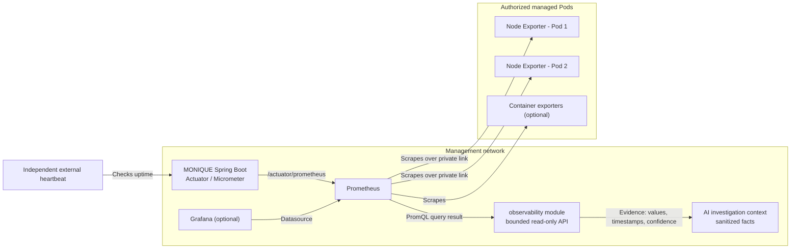

# Observability & monitoring architecture

**Document ID:** MON-OBS-001 · **Status:** Target design (NOT implemented) · **Updated:** 2026-11-14

## Decision and scope

Instrument MONIQUE with **Spring Boot Actuator + Micrometer** and use **Prometheus** as the default metrics query/store. **Grafana** provides optional dashboards and alert visualization; it is *not required* to operate MONIQUE. Hosts may run approved exporters (for example Node Exporter); operators can attach **existing** Prometheus/Grafana installations instead of deploying a new one.

The metric pipeline serves both the infrastructure domain (Pods, services, workload health) and MONIQUE's own control-plane reliability. It must remain read-only relative to server execution.

| Capability | Proposed layer | Requirement |
|---|---|---|
| Control-plane liveness/readiness | Actuator health endpoints + external heartbeat | Required |
| Java/JVM/HTTP metrics | Micrometer -> private Prometheus endpoint | Required in operational deployment |
| Pod CPU/RAM/disk/network | Node Exporter or approved existing collector | Optional Pod onboarding feature |
| Container metrics | Approved Docker/cAdvisor-compatible exporter | Optional |
| Black-box probe / public availability | Dedicated external probe | Optional, recommended for user-facing services |
| Historical metric queries | Prometheus HTTP API through scoped connector | Recommended |
| Dashboards | Grafana Prometheus datasource | Optional |
| Logs | Redacted application audit and worker logs; Loki/OTel collector later | Separate concern; not promised in this phase |
| Traces | Micrometer Tracing + OpenTelemetry exporter | Later; controlled sampling |
| Security detection | Wazuh | Separate optional [Security Monitoring](SECURITY-MONITORING.md) domain |

## Metrics topology



**Important direction:** Prometheus **pulls/scrapes** exporters and the Actuator endpoint. Grafana reads from Prometheus. MONIQUE's `observability` connector queries Prometheus through a constrained server-side adapter; browsers and models never get direct Prometheus admin access.

## Proposed Spring implementation

Add to `backend/pom.xml` after a clean build:

```xml
<dependency>
  <groupId>org.springframework.boot</groupId>
  <artifactId>spring-boot-starter-actuator</artifactId>
</dependency>
<dependency>
  <groupId>io.micrometer</groupId>
  <artifactId>micrometer-registry-prometheus</artifactId>
</dependency>
```

Actuator exposes Prometheus data at `/actuator/prometheus` **only once the endpoint is enabled**. Keep that endpoint reachable only over the management network or authenticated proxy, never as an unauthenticated Internet endpoint. Health/readiness/liveness probes should expose no sensitive diagnostic details to unauthenticated users.

Example **target** `application.yml` snippet (not yet merged into production configuration):

```yaml
management:
  endpoints:
    web:
      exposure:
        include: health,info,prometheus
  endpoint:
    health:
      show-details: when_authorized
      probes:
        enabled: true
  metrics:
    tags:
      application: monique
```

Access must still be restricted by Spring Security, reverse proxy and firewall. Exposing the endpoint via configuration does **not** itself secure it.

## Metrics contracts and low-cardinality labels

Metric names below are **proposed**, not currently emitted:

| Metric | Type | Safe labels | Operational purpose |
|---|---|---|---|
| `monique_jobs_total` | Counter | `state`, `job_type` | Number of completed job transitions |
| `monique_job_duration_seconds` | Histogram | `job_type`, `outcome` | Execution latency and p95 |
| `monique_approvals_pending` | Gauge | `risk_tier` | Approval queue backlog |
| `monique_execution_steps_total` | Counter | `kind`, `outcome` | Worker error trend |
| `monique_connector_up` | Gauge | `connector_type`, `connector_id` with cardinality caps | Monitoring connector reachability |
| `monique_ai_requests_total` | Counter | `provider`, `status` | Model request volume and failure rate |
| `monique_ai_tokens_total` | Counter | `provider`, `direction` | Usage/cost investigation |
| `monique_inventory_age_seconds` | Gauge | controlled Pod identity only | Staleness of host inventory |

Never use `job_id`, `request_id`, arbitrary user text, SSH output, command strings, IP credentials, paths, email addresses or user-provided labels as metric labels. Correlation IDs belong in **logs/traces**, with retention and access controls.

## Signal lifecycle and data quality

Every normalized monitoring signal includes `source`, `podId`, `observedAt`, `ingestedAt`, `window`, `unit`, `value`, `queryId`, `freshness`, `connectorStatus` and `confidence` (where applicable).

Statuses: `CONNECTED`, `DEGRADED`, `STALE`, `UNAVAILABLE`. A missing metric is **UNKNOWN**, not a zero or an implicit healthy status. Target first-cut defaults (configurable): **30-second scrape interval**, **2-minute staleness threshold**, **15-day local retention** for small installations; actual retention and resource sizing require operator approval and load measurements.

**Alert examples (planned):**

- Target no longer scraped: `up{job="node"} == 0`, assuming job label `node` is deployed.
- Low disk: capacity threshold for an approved filesystem, excluding synthetic container mounts.
- Sustained memory pressure: verify memory and process/container evidence before proposing any restart.
- Control-plane API error rate and worker failure rate: alert independently of MONIQUE's chat system.
- Approvals blocked because source monitoring is stale: show the blocked check, not a fabricated verdict.

Alerts flow through the normalization layer, not directly to root shell tools.

## Connector contracts

- Prometheus API: read-only bounded `/api/v1/query` and `/api/v1/query_range`; whitelist query templates; cap result size, lookback and timeout.
- Grafana: authorized dashboard links, optional dashboard provisioning by an explicitly scoped service account; do not treat dashboard pixels as authoritative evidence.
- Host exporters: enrollment requires approval and a verified host; default to collecting minimal standard metrics, not arbitrary service content.
- Scrape targets: register per verified Pod IP/hostname, network route and collector version. Do not infer agent health from Pod metadata alone.
- Independent health checks: external heartbeat must be able to notify the operator even if MONIQUE API/database is down.

## Operational acceptance gates

- [ ] Metrics endpoint emits no secrets and is private by default.
- [ ] Prometheus queries are bounded; model text cannot specify an arbitrary URL or unbounded query.
- [ ] Exporter install/uninstall is an audited job requiring change approval.
- [ ] Historical metrics contain timestamps, units and retention metadata.
- [ ] Worker crash or Pod outage produces a visible `STALE` or `UNAVAILABLE` result, never healthy.
- [ ] Protected-service migration refuses cutover when required signals are missing; alternative independent checks must be approved explicitly.
- [ ] A clean sandbox run validates monitoring permissions, dashboard queries, and no resource contention on Minecraft/Pterodactyl Pods.

## Official documentation

- [Spring Boot Actuator Metrics](https://docs.spring.io/spring-boot/reference/actuator/metrics.html)
- [Prometheus HTTP API](https://prometheus.io/docs/prometheus/latest/querying/api/)
- [Grafana Prometheus data source](https://grafana.com/docs/grafana/latest/datasources/prometheus/)
- [Spring Boot Actuator endpoint security](https://docs.spring.io/spring-boot/reference/actuator/endpoints.html)
