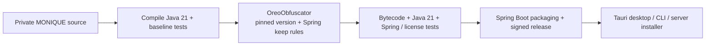

# MONIQUE release protection — OreoObfuscator

**ID:** MON-REL-001 · **Date:** 2026-11-14 · **Status: design plan only, NOT implemented**

## Goal and threat model

Integrate **OreoObfuscator** into MONIQUE's **production Java release pipeline**, making reverse engineering of the self-hosted Spring Boot/Spring Modulith Core and Java worker/CLI binaries more difficult. This is **defense in depth**, not an anti-crack guarantee. Customers control their local binaries and can patch local license checks, regardless of obfuscation. Only services Oreo Studios operates (e.g., paid hosted AI inference) can independently deny unauthorized requests server-side.

MONIQUE's own subscriptions and signed entitlements must remain separate from OreoObfuscator's license system; neither contains central license-signing private keys on the customer's machine.

Reference: private [OreoObfuscator source](https://github.com/OreoObfuscator/oreo-obfuscator) and [architecture](https://github.com/OreoObfuscator/oreo-obfuscator/blob/main/docs/architecture.md).

## Verified tool surface and compatibility assumptions

OreoObfuscator documents an engine and a headless CLI, with `LOAD → ANALYSE → TRANSFORM → FINALISE → VERIFY → WRITE` phases. Its transformer pipeline includes name, string, number and resource transformations, control-flow and experimental VM transformers, and it emits an obfuscated jar and `mapping.json`. Configuration uses immutable records and kebab-case YAML.

- **Tool build:** currently JDK **25**. MONIQUE targets **Java 21** runtime. Test the resulting Java 21 class files (major **65**) and injected helpers on a clean Java 21 runtime; a JDK 25 build process does not imply a Java 25 application requirement.
- **Tool licensing:** OreoObfuscator's `oreo-licensing` and private Maven contract are a separate build-tool entitlement, not MONIQUE's customer membership license. CI requires secure authorized access.
- **Spring compatibility is not verified yet.** Do not publish claims that the obfuscator already safely handles Spring Boot executable/fat jars, reflection, proxies, or Spring Modulith.

## Intended build and distribution flow

**Important:** prefer transforming MONIQUE-owned compiled classes/a thin application JAR **before** Boot's executable nested-JAR repackaging until fat-JAR compatibility is proved. Preserve `BOOT-INF`, manifest Main/Start-Class, `META-INF/spring`, `META-INF/services`, migrations and vendor resources. Never indiscriminately obfuscate Spring Framework, JDK or third-party SDKs.

Release signing, SBOM/provenance and installer checksums happen **after** obfuscation. Keep `mapping.json` in restricted CI release storage for stack trace decoding; do not ship it in public releases. Test and sign exactly the artifact customers install, not an earlier unobfuscated build.

## Spring Boot / Modulith keep-rule planning

| Compatibility area | Required treatment and regression tests |
|---|---|
| Spring Boot entrypoints, package scanning, `@Configuration` and beans | Keep required class/method/annotation metadata; startup and injection tests |
| Modulith module roots and `@ApplicationModule` named interfaces | Keep names/interfaces stable; rerun `ApplicationModules.verify()` and module tests |
| Spring Security, method authorization, AOP proxies | Preserve reflection/proxy/signatures; reject unauthorized requests after transformation |
| JSON REST DTOs, Jackson, event serialization | Preserve external field/type names and polymorphic descriptors; API contract tests |
| `@ConfigurationProperties`, validation, Actuator | Preserve binding keys, annotations and introspection; production config tests |
| Spring AI tool methods and provider integration | Keep tool callbacks and descriptors; test chat and tool planning behavior |
| Database migrations, SQL/resources and ServiceLoader | Preserve resource paths, `META-INF` and driver metadata; fresh/upgrade DB test |
| Worker SPI, extension discovery and reflective hooks | Keep public names, verify vendor adapters, job reconciliation and event handling |

**Safe initial profile:** conservative application-only renaming. Consider string/number protection after verification. **Do not enable experimental typed/classic virtualization or aggressive control-flow** on startup, security, licensing, serialization and worker-policy paths until verified in isolated test environments. Bytecode verification alone cannot prove Spring behavior.

## What it does and does not protect

| Artifact | OreoObfuscator | Alternative protections |
|---|---|---|
| Java 21 MONIQUE Core | Planned candidate | Code signatures, locked permissions, server-side membership |
| Java worker / CLI (if Java) | Planned candidate | Runtime permission isolation and approval gates |
| Tauri Rust executable | **No** | Signed native build, hardened IPC, update verification |
| React/TypeScript dashboard | **No** | Minification, CSP and avoiding frontend secrets |
| PostgreSQL data, SSH keys, installer manifests | **No** | Encryption, OS permissions, vault, signed artifacts |

Obfuscation does **not** replace proper authorization, access control, secure secrets or license signatures. No central Stripe, OAuth client secret, entitlements signing key or API billing secret may be packaged into the obfuscated Java artifact.

## CI and release checklist (all pending)

- [ ] Pin an OreoObfuscator version and inspect actual CLI flags/config format; don't invent an executable invocation.
- [ ] Verify compatibility with MONIQUE's Java 21 bytecode and Spring Boot packaging on all target runtimes.
- [ ] Create versioned Spring/Modulith keep rules; document exclusions for metadata/reflection.
- [ ] Compile/test baseline before obfuscation, then transform MONIQUE-owned classes only.
- [ ] Verify transformed binary on **Java 21**, not merely on the tool's JDK 25 environment.
- [ ] Run end-to-end startup, REST/API, AI tool, JSON, Spring Security, Modulith boundary, migration, entitlement and job/worker tests **on the transformed artifact**.
- [ ] Test expired/tampered licenses, missing central service/offline grace, failed approvals, interrupted migrations and protected Pods.
- [ ] Secure `mapping.json`, private Maven credentials and release signer keys; publish signatures and checksums of final artifacts.
- [ ] Integrate final output into the one-click desktop/server installer and validate update/rollback.
- [ ] Block release on any regression; do not silently ship an untested obfuscated build.

**Current state:** this page is a design and release gate. MONIQUE does not yet have OreoObfuscator wired into Maven, CI, its installer or its runtime.

See [Security](SECURITY.md), [Licensing](LICENSING-AND-BILLING.md), [Spring stack](SPRING-STACK.md), [Installation](INSTALLATION-AND-ONBOARDING.md), [ADR 0007](adr/0007-oreo-obfuscator-release-protection.md).
