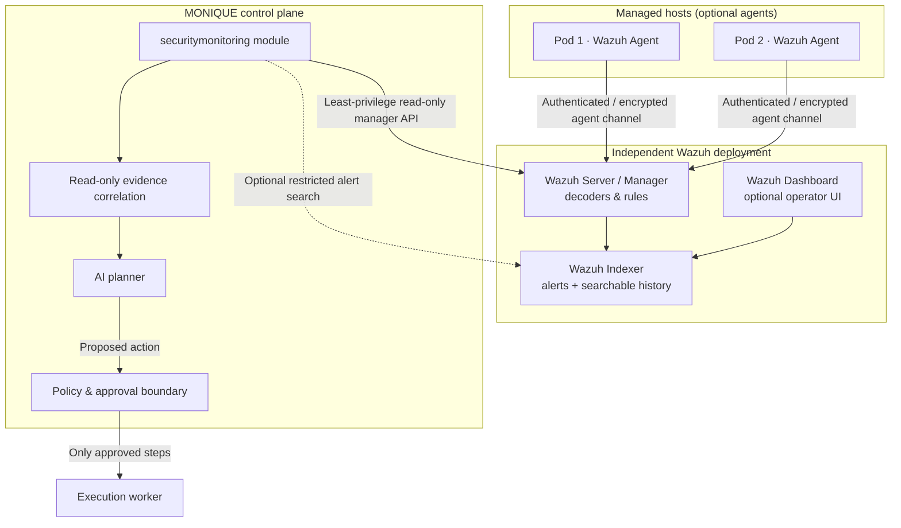
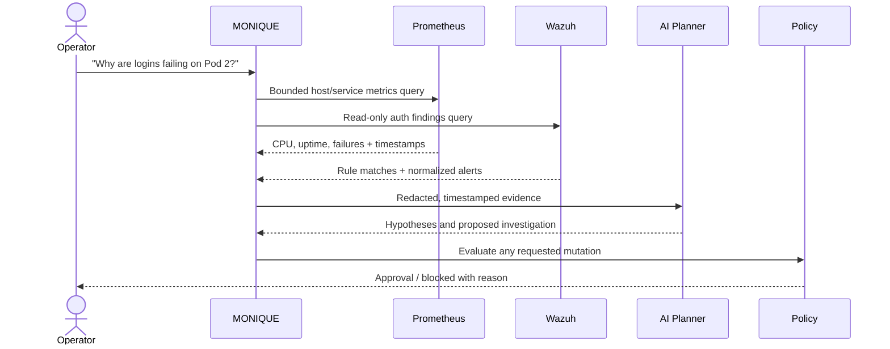

# Security monitoring & Wazuh integration

**Document ID:** MON-SEC-OBS-001 · **Status:** Target design / optional subsystem (NOT implemented) · **Updated:** 2026-11-14

## Architectural decision

**Wazuh is optional**. MONIQUE must function if no Wazuh server or agent is configured. Operators can connect an **existing** Wazuh instance or, in a later authorized workflow, provision a separate central stack and enroll selected Pods.

Wazuh is not a substitute for Prometheus: it processes **security events and findings**, not general-purpose host-time-series data. Its central components are the **Wazuh server/manager**, **indexer**, and **dashboard**. Each monitored endpoint can run a **Wazuh agent**. MONIQUE uses Wazuh read-only APIs for evidence, not for automatic active response.

## Security plane topology



The dashboard is optional for MONIQUE integration; MONIQUE does not screen-scrape it. Wazuh manager and indexer have different responsibilities, credentials, network and query permissions.

## Pod onboarding

1. Operator registers a Pod and verifies its host fingerprint and permitted network route.
2. MONIQUE detects whether Wazuh agent is already present; no automatic install from an AI message.
3. If Wazuh is requested, plan supported OS-specific agent installation and manager compatibility, then present impact, resource estimate and enrollment scope for approval.
4. Provision agent certificates/keys/tokens through a secrets vault; do not expose enrollment secrets in prompts or logs.
5. Verify agent/manager connection and record the Wazuh agent ID mapping to the Pod; record both `connected` and `lastSeen`.
6. Support disable/remove using separately approved jobs. Do not mutate Wazuh rules or active-response configuration implicitly.

**Resource planning:** Wazuh quickstart central stack for 1–25 agents recommends approximately **4 vCPU, 8 GiB RAM and 50 GB storage (90 days)**. Capacity depends on event rate, retention and indexing. Central Wazuh services belong on a separate host or existing cluster when production game-server resources are constrained.

## Read-only ingestion and normalization

The `securitymonitoring` module owns Wazuh connection metadata, API credentials **by vault reference**, agent mappings, alert cursors, data freshness and normalized findings.

Proposed `SecurityFinding` fields:

```text
id              // internal UUID
podId           // verified Pod identity / nullable until mapped
source          // WAZUH_MANAGER | WAZUH_INDEXER
sourceEventId   // original identifier, not an execution command
ruleId          // Wazuh rule identifier
category        // AUTH | FILE_INTEGRITY | VULNERABILITY | CONFIG | OTHER
severity        // normalized LOW | MEDIUM | HIGH | CRITICAL | UNKNOWN
title           // sanitized summary
observedAt      // event timestamp from source
ingestedAt      // time MONIQUE consumed it
evidenceRef     // authorized link/reference, not raw secret-rich payload
deduplicationKey
confidence      // heuristic/model or source reliability, never a guarantee
```

Wazuh server API supports agent status, group/rule information, syscheck and other manager state. Historical alert exploration may require access to indexed alert data through a **separately configured**, read-only indexer client. Don't assume the manager API returns every searchable alert document.

Implement a **pull** connector with cursor pagination, timestamps, bounded lookback and deduplication first; consider webhooks/events only when verified per source integration. If an agent is offline, distinguish its **absence of telemetry** from **absence of threats**.

## Correlation and incident workflow



**Example:** repeated SSH login failures and a sharp change in network activity may be suspicious, but they are not proof of compromise. MONIQUE should ask for corroboration and show source links, freshness and confidence before recommending a firewall or SSH configuration change.

**No direct alert-to-SSH path.** Wazuh rule severity may raise approval requirements but can never bypass them; disable Wazuh Active Response integration in MVP.

## Security and privacy controls

- Control-plane read-only service accounts; never reuse Wazuh admin credentials for analysis.
- TLS verification, endpoint allowlisting, timeouts, pagination and query cost limits.
- No raw alert log bodies in LLM prompts unless carefully redacted, scoped and authorized.
- Security findings may contain personally identifiable IPs/usernames, paths or tokens; enforce retention, viewer role checks and deletion policy.
- Treat Wazuh messages as untrusted content; malicious strings are data, not instructions.
- Severity mapping and false-positive handling require tests; record whether a finding was verified independently.
- Prohibit irreversible remediation without approval, a backup/rollback assessment and bounded execution authority.
- On Wazuh outage, show `UNAVAILABLE` / `STALE`, never `NO_THREATS`.

## Validation and phased rollout

- [ ] Connector can read manager health/agent status with read-only credentials.
- [ ] Connector rejects invalid TLS, unknown hosts, unsupported API versions and excessive indexer queries.
- [ ] Alert import is idempotent and tied to a verified Pod agent mapping.
- [ ] Malicious instruction embedded in a test alert never reaches a command executor.
- [ ] Wazuh absence leaves ordinary pod/AI features functional.
- [ ] Security issue does not trigger automatic firewall/service changes.
- [ ] End-to-end test: sandbox SSH failures produce visible, correctly attributed Wazuh findings, with non-matching baseline events handled.
- [ ] Human approval and verification precede any remediation job.

## Official references

- [Wazuh platform components](https://documentation.wazuh.com/current/getting-started/components/index.html)
- [Wazuh manager REST API](https://documentation.wazuh.com/current/user-manual/api/index.html)
- [Wazuh agent installation](https://documentation.wazuh.com/current/installation-guide/wazuh-agent/index.html)
- [Wazuh quickstart sizing](https://documentation.wazuh.com/current/quickstart.html)
