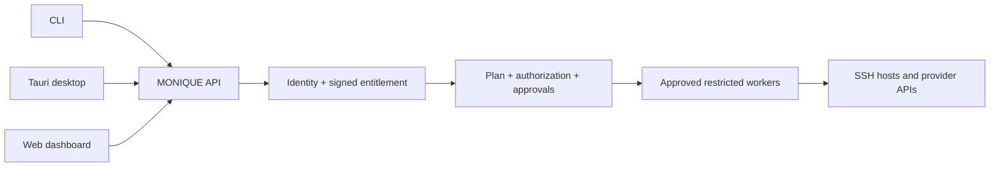

# MONIQUE self-hosting and CLI architecture

**Document:** MON-DEP-001 · Revision 1.0 · 2026-11-14 · **Status: proposed, not implemented**

## Goal

Allow the operator to run MONIQUE on their own hardware in three forms: **local interactive CLI**, **native Tauri desktop**, or **always-on self-hosted Spring Boot server** with optional browser panel. The same Spring API owns Pod registration, encrypted credentials, AI planning, policy, approvals and durable execution. None of these clients gets a privileged shell shortcut.

## Product and business split

- **Customer-owned:** local/runtime process, managed Pod/SSH secrets, job state and logs, provider connections, database and backups.
- **Oreo Studios-hosted:** account sign-in, monthly membership management, signed license entitlements and optional paid AI gateway.
- **Provider-owned (BYOK):** Claude/OpenAI API account/billing keys when customers choose direct model API use.

A membership is expected for premium features, **even when the app is self-hosted**. Prices, free tier, AI quotas, terms and final grace rules have not been selected. Separate license validity from authorization to modify machines.

## Deployment modes

| Mode | Runtime location | Operator clients | Durable background jobs |
|---|---|---|---|
| `LOCAL_INTERACTIVE` | Customer computer, user-scoped local backend | CLI/Desktop | Only while local supervisor+workers remain alive and recover correctly |
| `SELF_HOSTED_SERVER` | Customer VPS/dedicated machine | CLI/Desktop/Web | Yes, once durable worker and job recovery are built |
| `REMOTE_CLIENT` | CLI/Desktop on operator device, backend on customer server | CLI/Desktop | Remote server owns the job lifecycle |

### Shared flow



The CLI can open the desktop client via a future `monique desktop` command, but the desktop **must use the typed API rather than parse CLI stdout**. Shared DTOs, job IDs, confirmation fingerprints and error codes prevent different UI behavior.

## The customer installs one product, not each service (target)

MONIQUE's deployment diagram includes Core, PostgreSQL, workers and UI components, but those are **installer-managed internal components**. A normal supported installation must not ask a customer to install Java, run PostgreSQL commands or configure the worker individually.

- **Desktop Local:** a signed Tauri installer provisions the matching Java runtime, local PostgreSQL data directory, MONIQUE Core, restricted worker and authenticated local IPC; verifies health; then starts the sign-in + membership + AI + Pod setup wizard.
- **Self-hosted Server:** one guided bootstrap flow checks system prerequisites, provisions the approved Core/PostgreSQL/worker stack (and optional web dashboard), sets up secrets, data volumes, update policy, and authenticated HTTPS if configured; tests readiness. Docker installation or privileges must be handled with explicit consent rather than assumed.
- **Remote Client:** install only the CLI/Desktop app, connect over TLS to an existing MONIQUE server; **no local backend or database is installed**.

It may still be three internal processes/containers, but installation and upgrades are managed centrally through MONIQUE's installer. Never pretend setup succeeded if one component is unhealthy. On failure, leave a repairable installation without destroying preexisting customer data.

**Product journey:** Download → Install → Sign in & activate membership → Choose AI provider → Add first Pod → Read-only diagnostics/chat.

See [Installation & Onboarding](INSTALLATION-AND-ONBOARDING.md).

## CLI planned contract

```powershell
monique login
monique license status
monique pod add
monique pod list
monique ai provider claude
monique chat
monique desktop
monique connect --url https://monique.example.net
```

The commands above are **illustrative only**. `pod add` prompts for hostname/IP, host-key trust, a scoped SSH identity and a private credential storage method. `chat` streams planning responses, shows which Pod/operation is in scope, and requires explicit confirmation for write jobs. Never log raw credentials or pass an arbitrary shell command from a model to the worker.

## Local persistence constraint

**Current prototype uses Spring JDBC + PostgreSQL**, not a portable embedded DB. A true offline desktop runtime requires a tested strategy: provision a local user-scoped PostgreSQL service, attach to an explicitly configured existing PostgreSQL, or separately design and validate a storage abstraction/migration to another local database. Do **not** switch databases implicitly to make a packaging claim.

For supported one-click local releases, a compatible Java 21 runtime **must be automatically packaged/provisioned** (not manually required), and startup/shutdown/recovery must be tested on Windows/macOS/Linux. Local mode must never bind to public interfaces or install system services without consent. A terminal exit must not leave an approved migration half-complete.

## Proposed packaging

- Windows: signed CLI binary/installer and Tauri desktop installer; PowerShell supported.
- macOS: signed/notarized desktop bundle and CLI, Keychain for tokens, zsh.
- Linux: signed release packages/AppImage as appropriate, bash/zsh, protected user config.
- Server: Docker Compose/systemd with PostgreSQL, secure reverse proxy, durable workers and backed-up state.

Never distribute a generic provisioning script that runs as root without reviewed checks. Every installer has a checksum, provenance and rollback/version policy.

## Lifecycle and acceptance tests

- [ ] Sign in using a browser/device flow with secure token storage; show license status.
- [ ] Add and inspect a Pod without exposing a private key in AI, logs or frontend state.
- [ ] Use one approval workflow across CLI, desktop and browser UI.
- [ ] Restart local sidecar safely and detect/reconcile interrupted jobs.
- [ ] Remote Desktop/CLI reconnect to running jobs without replaying them.
- [ ] Read-only and emergency recovery remain available on membership expiry.
- [ ] Test Windows, macOS and Linux installer signatures and update safety.
- [ ] Production self-hosted server deployment passes vulnerability and integration tests.

See [Desktop Architecture](DESKTOP-APP.md), [Licensing](LICENSING-AND-BILLING.md), [ADR 0004](adr/0004-self-hosted-cli-membership.md).
