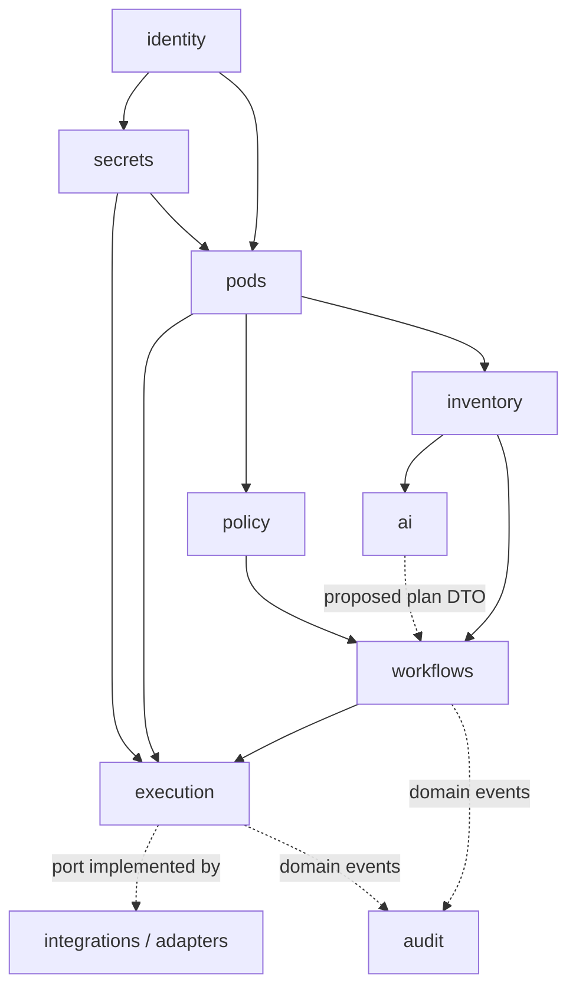
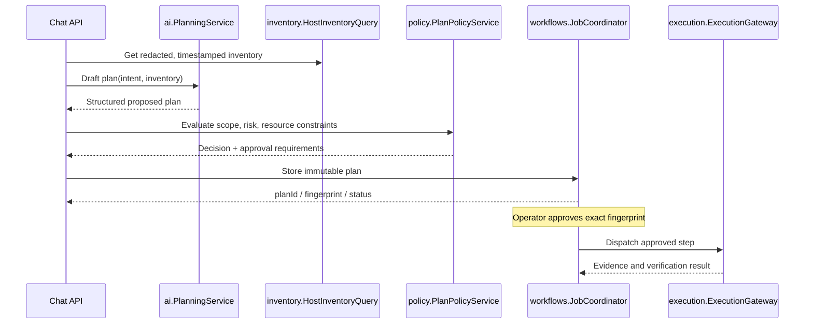
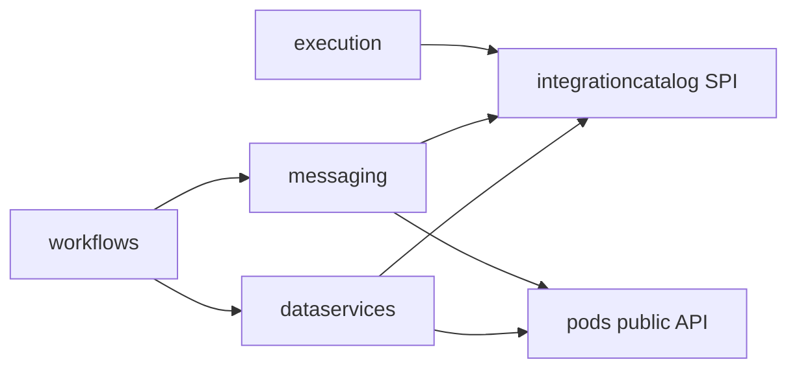
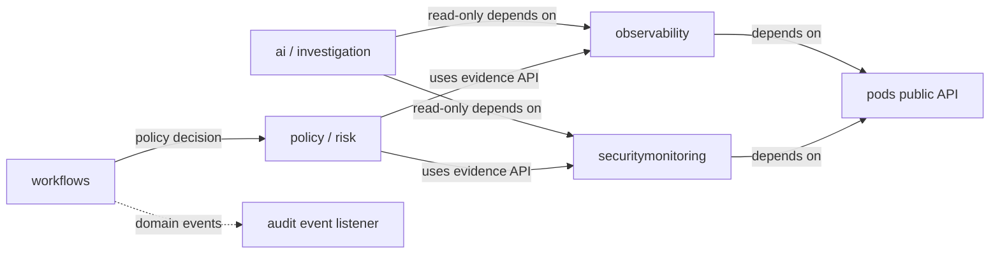
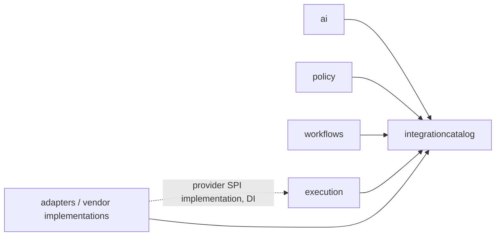

# Spring Modulith design

**Architectural decision:** one Spring Boot deployment partitioned by bounded contexts, not technical-layer packages. The root package `fr.oreostudios.monique` contains the `MoniqueApplication` class. Each immediate subpackage represents a Spring Modulith module.

## Target modules and responsibilities

| Module | Owns | Public contracts | May depend on |
|---|---|---|---|
| `identity` | Users, operators, authorization identity, tenant scope | `OperatorIdentity`, `AuthorizationService` | none |
| `secrets` | Credential encryption, vault adapter, secret lifecycle | `CredentialRef`, `SecretAccessService` | `identity` |
| `pods` | Host metadata, IPs, labels, enrollment | `PodDirectory`, `PodSummary`, `PodRegistered` | `identity`, `secrets` |
| `inventory` | Sanitized observed host/services/ports, freshness | `HostInventoryQuery`, `InventoryRecorded` | `pods` |
| `observability` | Prometheus metrics queries, normalization, freshness, monitoring alerts | `MonitoringQuery`, `MonitoringSignal` | `pods` |
| `securitymonitoring` | Optional Wazuh integration, normalized findings and security correlation | `SecurityFindingReader`, `SecurityFinding` | `pods` |
| `ai` | Prompt construction, provider router, plan drafting | `PlanningService`, `ProposedPlan` | `inventory`, `pods` |
| `policy` | Capability scopes, protected services, risk scoring | `PlanPolicyService`, `PolicyDecision` | `identity`, `pods` |
| `workflows` | Plans, approvals, job states, resource locks | `JobCoordinator`, `JobApproved` | `policy`, `pods` |
| `execution` | Claim/lease step, adapter dispatch, evidence | `ExecutionGateway`, `StepResult` | `workflows`, `secrets`, `pods` |
| `audit` | Append-only operator/action evidence | `AuditSink`, `AuditEvent` | none |
| `integrations` | Vendor-specific ports/adapters | vendor-specific interfaces | `execution`; revisit dependency inversion |
| `notifications` | Status notification consumers | `NotificationSink` | none |

**Important:** this table is a *logical decomposition*. Several current classes are still in `api/`, `security/`, `pods/` and `ai/`. An adapter module must not form a cycle by importing `execution` while `execution` imports adapter implementation. Final design uses ports owned by `execution`; adapters implement those ports and are wired by dependency injection, not referenced by compile-time imports from `execution`.

## Target dependency graph



Dashed arrows represent *conceptual flows/events*, **not necessarily Java dependencies**. The formal Java graph must remain acyclic; external events and the orchestration application layer coordinate cross-module calls.

## Package rule

```text
fr.oreostudios.monique
├── MoniqueApplication.java
├── pods/                  # module root: exposed API types only
│   ├── PodDirectory.java
│   ├── PodSummary.java
│   ├── package-info.java  # @ApplicationModule(allowedDependencies=...)
│   └── internal/          # private implementation; no incoming module refs
│       ├── PodService.java
│       ├── PodRepository.java
│       └── web/PodController.java
├── ai/
│   ├── PlanningService.java
│   └── internal/
├── policy/
│   ├── PlanPolicyService.java
│   └── internal/
├── workflows/
│   ├── JobCoordinator.java
│   └── internal/
└── ...
```

When another module needs a type, expose it from the module root (or a `@NamedInterface` package), not from `internal`. Use `@ApplicationModule(allowedDependencies = {"pods", "policy"})` to reject unapproved edges. Do **not** use OPEN modules as a permanent workaround.

## Runtime interaction: design intent



### Synchronous versus event interactions

- **Synchronous** for simple bounded queries and immediate policy decisions.
- **Transactional domain events** for best-effort decoupling within the control plane, e.g., `PodRegistered` or `PlanApproved`.
- **Durable job store and worker leases** for actions that take minutes/hours or cross host boundaries; do not use `@Async` alone for migration durability.
- **Event publication registry** (Spring Modulith JDBC) can persist transactional event delivery; it is not a replacement for the job state machine.

## Executable boundary test

```java
@Test
void moduleBoundariesRemainAcyclic() {
    ApplicationModules.of(MoniqueApplication.class).verify();
}
```

Add `spring-modulith-starter-test` to the test scope. Configure `@ApplicationModuleTest` for each bounded context (Pod CRUD, secrets, policy, job approval), using Testcontainers for PostgreSQL integration. Spring Modulith documentation generation can produce C4/PlantUML diagrams and module canvases; review generated output in CI, don't assume diagrams alone verify safety.

## Anti-patterns to block in review

- `ai.internal` directly invoking `ssh.exec("sudo ...")`.
- `pods` reading `secrets.internal.SecretEntity` or using foreign module tables directly.
- Web controllers directly mutating workflow job rows.
- Synchronous long-running SSH inside an HTTP request thread.
- “Approved” state without plan-hash binding and expiry.
- Sharing credential decrypted values via events or serialization.

See [Architecture](ARCHITECTURE.md), [Execution](EXECUTION-AND-MIGRATIONS.md), [Spring stack](SPRING-STACK.md).

## Data service and broker bounded contexts (target)

| Module | Domain ownership | Public contract | Allowed dependencies |
|---|---|---|---|
| `dataservices` | SQL/NoSQL/cache inventory, versions, backup and recovery evidence | `DataServiceDirectory`, `BackupEvidence` | `pods`, `integrationcatalog` |
| `messaging` | RabbitMQ/Kafka/NATS brokers, queue/topic topology, consumer/health evidence | `BrokerDirectory`, `BrokerTopology` | `pods`, `integrationcatalog` |



These arrows represent **proposed Java dependencies**; they are acyclic and must be verified using `ApplicationModules.of(MoniqueApplication.class).verify()`. Only `workflows` may coordinate actionable lifecycle plans; `execution` invokes approved operations through the SPI. AI, Web controllers and these management modules cannot directly perform SSH writes. Adapter implementation packages must never be imported from the control plane.

**Status:** proposed module interfaces, not implemented Java classes. See [DATA-SERVICES.md](DATA-SERVICES.md).


## Kubernetes integration bounded context (target)

A new **`kubernetes`** module owns cluster registration metadata, sanitized namespace/workload/Service/Ingress/Gateway inventories and versioned operation previews. Its public contracts are `ClusterDirectory`, `KubernetesServiceQuery`, `GatewayCapabilityQuery` and `KubernetesOperationPreview`. It may depend on `integrationcatalog` and `pods` public APIs for verified host correlations, but never imports `execution.internal` or raw secrets. It does **not** own the execution approval state.

`workflows` coordinates scoped plans, `policy` approves and `execution` dispatches restricted Kubernetes API workers. Distinguish `KubernetesWorkloadPod` from MONIQUE's `Pod` host type in code and the UI.

Kubernetes Services and Ingress/Gateway are **resources inside one integration**, not seven distinct provider connector brands. Gateway resources require supported CRDs/controller discovery; NetworkPolicy requires a CNI with enforcement.

[Full design and compatibility requirements](KUBERNETES-NETWORKING.md). **No Java implementation currently exists.**


## Monitoring bounded contexts

Add **two** modules to the target Spring Modulith application. No monitoring or security adapter may hold a reference to `execution.internal` or invoke write-capable ports.

| Target module | Owns | Public API surface | Allowed inward dependencies |
|---|---|---|---|
| `observability` | Metric-provider registration, bounded PromQL queries, metrics normalization, freshness and alerts | `MonitoringQuery`, `MetricSeries`, `MonitoringSignal`, `ConnectorHealth` | `pods` |
| `securitymonitoring` | Wazuh manager/indexer connector metadata, read-only findings, incident correlation, risk evidence | `SecurityFindingReader`, `SecurityFinding`, `SecurityConnectorHealth` | `pods` |

The **`ai` module** may depend on their public read-only query APIs to construct a redacted `InvestigationContext`, and **`policy`** may consider normalized evidence in a risk evaluation. The **`workflows`** module alone owns the approval/job lifecycle; evidence events may be consumed by `notifications` and `audit` through public event contracts. External monitoring platforms do not own Monique's job or approval state.



The arrows above depict **Java API dependency** except the dotted event listener edge. This graph is intentionally separate from the orchestration runtime sequence; don't infer control-plane execution authority from a metrics read.

**Enforcement example** (future refactoring, not yet present):

```java
// fr.oreostudios.monique.observability.package-info.java
@org.springframework.modulith.ApplicationModule(allowedDependencies = "pods")
package fr.oreostudios.monique.observability;
```

- `observability.internal.prometheus` implements a strictly read-only connector with timeout and query budgets.
- `securitymonitoring.internal.wazuh` normalizes alert severity, evidence timestamp and Pod correlation without running Wazuh active-response operations.
- `ai` sees sanitized DTOs only; it cannot deserialize connector credentials or raw indexer documents.
- `policy` rejects stale signal-based assertions and validates protected-resource implications.
- `ApplicationModules.of(MoniqueApplication.class).verify()` must fail for forbidden internal-package dependencies.
- Contract tests cover disabled integrations, read-only permissions, malformed responses, partial outages and injection-bearing alert text.

**Current implementation status:** these module packages and contracts are design targets, not committed Java classes. The existing `pods`, `ai`, `api` and `security` packages have not been fully refactored into this Modulith structure.


## Integration catalog / provider adapters (target refinement)

The earlier logical `integrations` entry is refined into a **public `integrationcatalog` SPI module** and internal provider implementations. The SPI owns immutable descriptors, capability names, version negotiation and provider scopes. It does **not** execute SSH, run a deployment, or grant policy approval. `execution` depends on the SPI, not concrete provider packages. Adapter implementations register with the SPI and are invoked by an approval-verified worker.

Potential logical service surfaces: `ConnectedAccountDirectory`, `InstallationDirectory`, `IntegrationDescriptorRegistry`, `IntegrationDiscovery`, `CapabilityResolver`. Both `observability` and `securitymonitoring` remain separate read-only bounded contexts, rather than becoming arbitrary provider write adapters.



**No cycle rule:** the dotted runtime edge above is *not* a compile-time import. If implemented as Spring Modulith package roots, enforce it with `ApplicationModules.verify()` and `@ApplicationModule(allowedDependencies = ...)`. Provider drivers may not reference `ai.internal`, `policy.internal` or `execution.internal` and may not be invoked from controllers directly.

See [Integration Architecture](INTEGRATION-ARCHITECTURE.md) and the [catalog](INTEGRATIONS.md).
