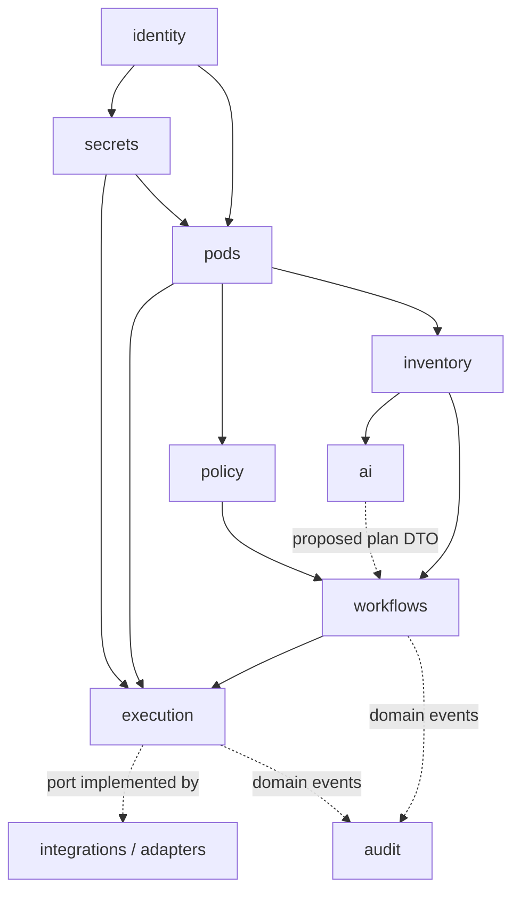
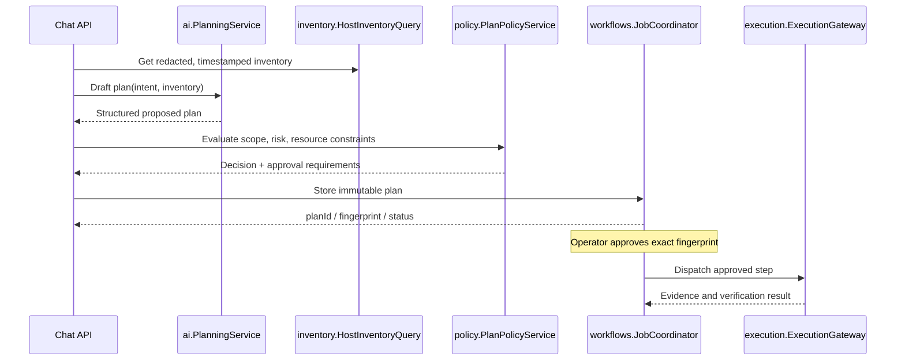

# Spring Modulith design

**Architectural decision:** one Spring Boot deployment partitioned by bounded contexts, not technical-layer packages. The root package `fr.oreostudios.monique` contains the `MoniqueApplication` class. Each immediate subpackage represents a Spring Modulith module.

## Target modules and responsibilities

| Module | Owns | Public contracts | May depend on |
|---|---|---|---|
| `identity` | Users, operators, authorization identity, tenant scope | `OperatorIdentity`, `AuthorizationService` | none |
| `secrets` | Credential encryption, vault adapter, secret lifecycle | `CredentialRef`, `SecretAccessService` | `identity` |
| `pods` | Host metadata, IPs, labels, enrollment | `PodDirectory`, `PodSummary`, `PodRegistered` | `identity`, `secrets` |
| `inventory` | Sanitized observed host/services/ports, freshness | `HostInventoryQuery`, `InventoryRecorded` | `pods` |
| `ai` | Prompt construction, provider router, plan drafting | `PlanningService`, `ProposedPlan` | `inventory`, `pods` |
| `policy` | Capability scopes, protected services, risk scoring | `PlanPolicyService`, `PolicyDecision` | `identity`, `pods` |
| `workflows` | Plans, approvals, job states, resource locks | `JobCoordinator`, `JobApproved` | `policy`, `pods` |
| `execution` | Claim/lease step, adapter dispatch, evidence | `ExecutionGateway`, `StepResult` | `workflows`, `secrets`, `pods` |
| `audit` | Append-only operator/action evidence | `AuditSink`, `AuditEvent` | none |
| `integrations` | Vendor-specific ports/adapters | vendor-specific interfaces | `execution`; revisit dependency inversion |
| `notifications` | Status notification consumers | `NotificationSink` | none |

**Important:** this table is a *logical decomposition*. Several current classes are still in `api/`, `security/`, `pods/` and `ai/`. An adapter module must not form a cycle by importing `execution` while `execution` imports adapter implementation. Final design uses ports owned by `execution`; adapters implement those ports and are wired by dependency injection, not referenced by compile-time imports from `execution`.

## Target dependency graph



Dashed arrows represent *conceptual flows/events*, **not necessarily Java dependencies**. The formal Java graph must remain acyclic; external events and the orchestration application layer coordinate cross-module calls.

## Package rule

```text
fr.oreostudios.monique
├── MoniqueApplication.java
├── pods/                  # module root: exposed API types only
│   ├── PodDirectory.java
│   ├── PodSummary.java
│   ├── package-info.java  # @ApplicationModule(allowedDependencies=...)
│   └── internal/          # private implementation; no incoming module refs
│       ├── PodService.java
│       ├── PodRepository.java
│       └── web/PodController.java
├── ai/
│   ├── PlanningService.java
│   └── internal/
├── policy/
│   ├── PlanPolicyService.java
│   └── internal/
├── workflows/
│   ├── JobCoordinator.java
│   └── internal/
└── ...
```

When another module needs a type, expose it from the module root (or a `@NamedInterface` package), not from `internal`. Use `@ApplicationModule(allowedDependencies = {"pods", "policy"})` to reject unapproved edges. Do **not** use OPEN modules as a permanent workaround.

## Runtime interaction: design intent



### Synchronous versus event interactions

- **Synchronous** for simple bounded queries and immediate policy decisions.
- **Transactional domain events** for best-effort decoupling within the control plane, e.g., `PodRegistered` or `PlanApproved`.
- **Durable job store and worker leases** for actions that take minutes/hours or cross host boundaries; do not use `@Async` alone for migration durability.
- **Event publication registry** (Spring Modulith JDBC) can persist transactional event delivery; it is not a replacement for the job state machine.

## Executable boundary test

```java
@Test
void moduleBoundariesRemainAcyclic() {
    ApplicationModules.of(MoniqueApplication.class).verify();
}
```

Add `spring-modulith-starter-test` to the test scope. Configure `@ApplicationModuleTest` for each bounded context (Pod CRUD, secrets, policy, job approval), using Testcontainers for PostgreSQL integration. Spring Modulith documentation generation can produce C4/PlantUML diagrams and module canvases; review generated output in CI, don't assume diagrams alone verify safety.

## Anti-patterns to block in review

- `ai.internal` directly invoking `ssh.exec("sudo ...")`.
- `pods` reading `secrets.internal.SecretEntity` or using foreign module tables directly.
- Web controllers directly mutating workflow job rows.
- Synchronous long-running SSH inside an HTTP request thread.
- “Approved” state without plan-hash binding and expiry.
- Sharing credential decrypted values via events or serialization.

See [Architecture](ARCHITECTURE.md), [Execution](EXECUTION-AND-MIGRATIONS.md), [Spring stack](SPRING-STACK.md).
